# ZX Evolution Обновление прошивок

(версия от 08.02.2026) www.nedopc.com

## Назначение

Базовый загрузчик (boot loader) предназначен для обновления flash-памяти периферийного контроллера (ATMEGA128) компьютера ZX Evolution.

Во flash-памяти периферийного контроллера хранятся данные для FPGA и программное обеспечение самого контроллера, что в совокупности являются конфигурацией компьютера ZX Evolution. Базовый загрузчик позволяет пользователю самостоятельно обновлять конфигурацию компьютера.

Официальные конфигурации ZX Evolution доступны с сайта разработчика ([www.nedopc.com](http://www.nedopc.com/)). Но возможна загрузка альтернативных конфигураций от других разработчиков.

Имеется два способа загрузить прошивки в компьютер:

- используя SD-карту;
- посредством нуль-модемного кабеля.

## Обновление с помощью SD-карты

1.  В корневую директорию на SD-карточку (MMC-карточки не поддерживаются), отформатированную в FAT12, FAT16 или FAT32, запишите файл прошивки (ZXEVO_FW.BIN) и установите её в картодержатель на плате ZX Evo.
2.  Удерживая нажатой кнопку SoftReset, включите питание компьютера (или кратковременно нажмите HardReset, если компьютер уже включен).

Через несколько секунд компьютер загрузится уже с новой прошивкой.

Процесс обновления никак не отображается на экране. Об ошибках можно судить по светодиоду PWR LED (VD6) и сигналу бипера. Количество сигналов бипера указывает на одну из возможных проблем:

- 1 сигнал - не обнаружена SD-карта;
- 2 сигнала - ошибка чтения сектора;
- 3 сигнала - не найдена файловая система на SD-карте;
- 4 сигнала - не найден файл прошивки;
- 5 сигналов - файл прошивки повреждён.

Более интерактивный и информативный способ обновления через RS-232.

## Обновление с помощью нуль-модемного кабеля

1.  Соедините разъём RS-232 нуль-модемным кабелем c COM-портом другого компьютера, на котором запустите терминальную программу (настройки: скорость 115200, без проверки четности, 8 бит, 2 стоп-бита, без управления потоком)
2.  Удерживая нажатой кнопку SoftReset, включите питание компьютера (или кратковременно нажмите HardReset, если компьютер уже включен).
3.  После появления надписи «Try update from RS-232...» стартуйте передачу файла прошивки (ZXEVO_FW.BIN) протоколом X-Modem-CRC.

По окончании загрузки компьютер загрузится уже с новой прошивкой.

Может использоваться упрощенный кабель из трёх проводов.

| Цепь X1 | Контакт X1|  | Контакт X2 | Цепь X2 |
| --- | ---: | --- | ---: | --- |
| RXD | 2 | <-> | 3 | TXD |
| TXD | 3 | <-> | 2 | RXD |
| GND | 5 | <-> | 5 | GND |
X1, X2 – D-Sub9F

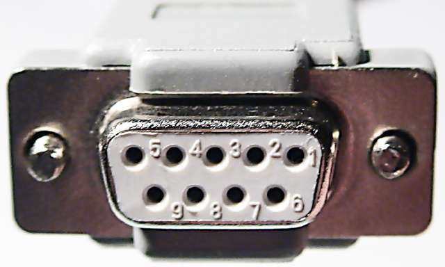

## Пример загрузки с помощью нуль-модемного кабеля из программы HyperTerminal

Один конец кабеля подключите к разъёму RS-232 на плате ZX Evolution, другой к COM-порту PC.

Запустите HyperTerminal.

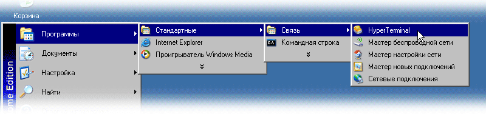

Если Вы до сего момента ни разу не пользовались HyperTerminal-ом, то но задаст пару странных вопросов.

Установите галочку и ответе, например, «Да».

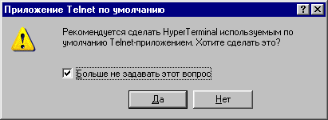

Введите цифры в поле «Телефонный код города» (иначе запрос будет повторяться при каждом запуске).

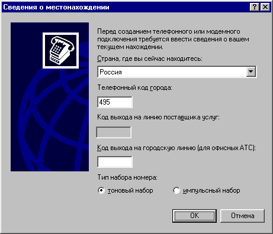

Задайте имя «подключения». Все дальнейшие настройки можно сохранить в файле с этим именем и не вводить каждый раз заново.

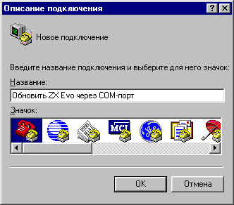

Выберите из списка порт, к которому вы подключили кабель.

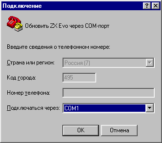

Установите параметры порта, как показано на картинке.

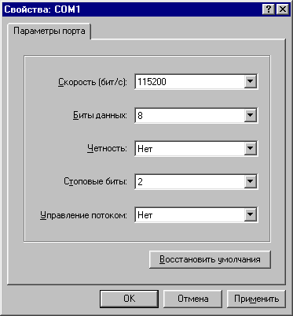

Удерживая нажатой кнопку SoftReset, включите питание ZX Evo.

После появления заставки отпустите кнопку SoftReset.

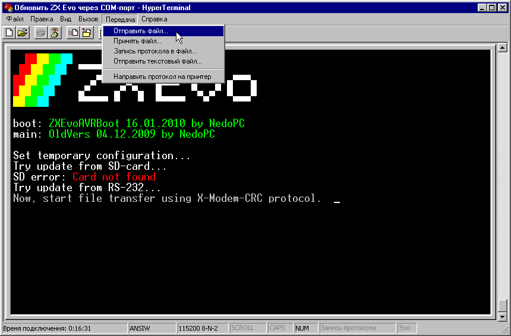

Выберите файл прошивки (ZXEVO_FW.BIN), выберите протокол «X-Modem» и кликните «Отправить».

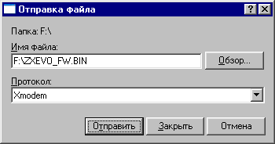

Примечание: Если вы не начнёте передачу файла в течении 1 минуты, то ZX Evo выйдет из режима обновления и просто запустится со старой прошивкой.

Процесс обновления занимает буквально несколько секунд.

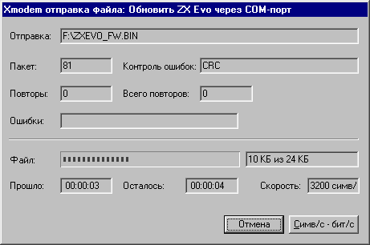

При успешном обновлении в окне терминала появится строчка с её идентификатором, а компьютер запускается уже с новой прошивкой.

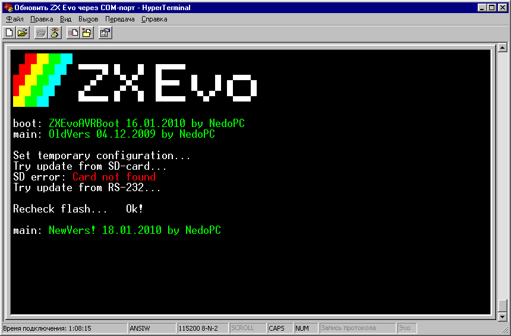
