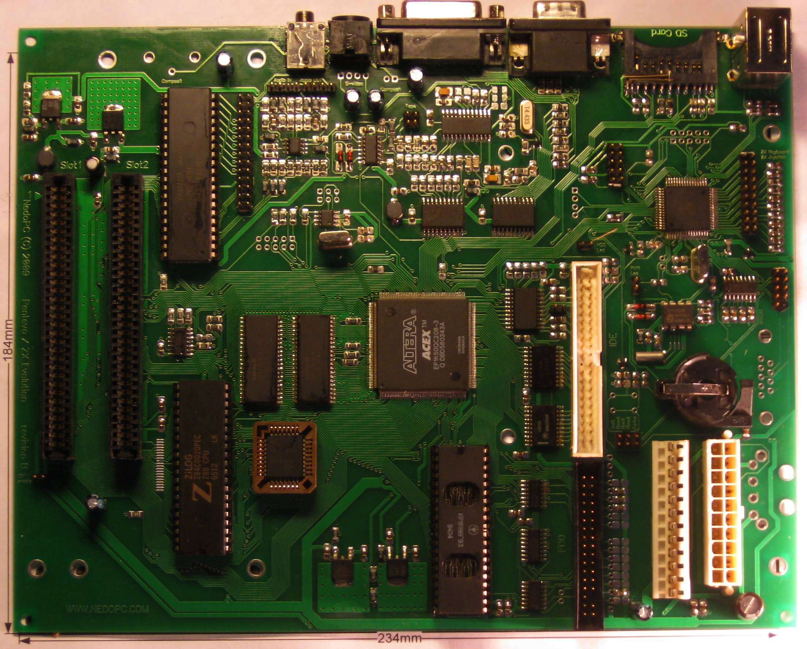
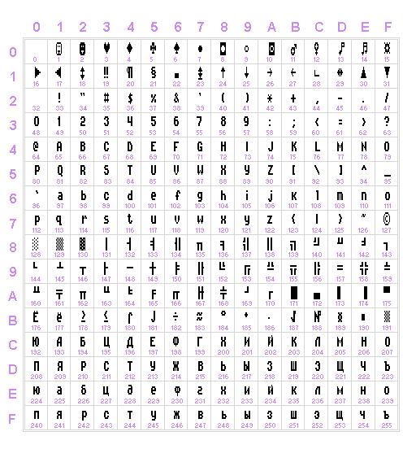

# Базовая конфигурация ZX Evolution

Руководство пользователя.

## 1 Введение

Под базовой конфигурацией компьютера ZX Evolution подразумевается конфигурация, которая поставляется и поддерживается производителем. Производитель осуществляет поддержку и развитие этой конфигурации и исправление найденных в ней ошибок. Группа NedoPC не поддерживает конфигурации сторонних разработчиков, в случае проблем с такими конфигурациями, обращайтесь непосредственно к их разработчикам.

Базовая конфигурация состоит из следующих компонент:

- Конфигурация для FPGA EP1K50QC208;
- Программа для микроконтроллера ATMEGA128.

Конфигурация поставляется в виде бинарного файла (zxevo_fw.bin), который можно загрузить в микроконтроллер ATMEGA128 с помощью BOOTLOADER[^1]. Обновление конфигураций, также производится с помощью BOOTLOADER.

Конфигурация FPGA интегрирована в программу микроконтроллера. Конфигурирование FPGA производится при включении или железном сбросе компьютера.

Изменение версии базовой конфигурации подразумевает изменение любой из или обеих компонент.

## 2 Управляющие контакты компьютера

Управляющие группы контактов компьютера, предназначены для управления работой компьютера с помощью подсоединенных к ним элементов управления (например кнопок на корпусе компьютера).

### 2.1 Hard reset (полный сброс)

Группа контактов «Hard reset» осуществляет полный сброс компьютера (с перезапуском прошивки микроконтроллера и перепрограммированием FPGA) при замыкании контактов. Функционирование не зависит от используемой конфигурации компьютера.

Рекомендуется при использовании стандартного (AT или ATX) корпуса подсоединить к кнопке «Reset» корпуса.

**Внимание!** Hard Reset *не обеспечивает* сохранность содержимого памяти компьютера (например, RAM-дисков или страничек с исходными текстами в аласме).

### 2.2 Soft reset (мягкий сброс)

Функции группа контактов «Soft reset» зависят от конфигурации.

В базовой конфигурации на эту группу контактов возложены две функции:

- мягкий сброс компьютера (сброс процессора и внутренних регистров fpga);
- включение/выключение ATX блока питания.

Рекомендуется при использовании стандартного ATX корпуса подсоединить к кнопке «Power» корпуса. В этом случае включение компьютера осуществляется однократным нажатием кнопки. Отключение компьютера осуществляется долговременным нажатием в течении 5 секунд.

Кратковременное замыкание контактов будет осуществлять мягкий сброс компьютера и установку нулевой страницы ROM.

Мягкий сброс обеспечивает сохранность содержимого памяти компьютера.

### 2.3 NMI (подача немаскируемого прерывания на процессор Z80)

Функции группы контактов «NMI» зависят от конфигурации.

В базовой конфигурации на эту группу контактов возложены функции подачи немаскируемого прерывания процессор на процессор Z80 (аналогично описанному в [3.5](#anchor-5)).

**Внимание!** Для revision A и B плат эта группа контактов называется «Turbo», но используется как контакты для управления NMI.

## 3 Дополнительные функции PS2 клавиатуры

При использовании PS2 клавиатуры с компьютером ZX Evolution можно использовать дополнительные возможности по управлению компьютером:

- мягкий сброс компьютера;
- полный сброс компьютера;
- переключение режима видеовыхода (TV/VGA);
- переключение режима аудиовыхода (beeper/tapeout);
- подача NMI на процессор Z80.

### 3.1 Мягкий сброс компьютера (soft reset)

Мягкий сброс компьютера осуществляется с помощью кратковременного (менее 5секунд) нажатия клавиши «F12».

### 3.2 Полный сброс компьютера (hard reset)

Полный сброс компьютера с клавиатуры можно осуществить двумя способами:

- Длительным нажатием клавиши «F12» (длительностью 5сек), отключение питания в этом случае не производится;
- Нажатием комбинации «Ctrl-Alt-Del», отключение питания в этом случае не производится.

### 3.3 Переключение режима видеовыхода (TV/VGA)

Так как используется объединенный видеовыход (в связи с ограничением количества ног микросхемы EP1K50QC208), то необходимо установить режим видеовыхода:

- TV – скандаблер отключен, видеовыход работает с телевизионной разверткой;
- VGA – включен скандаблер, видеовыход работает с VGA разверткой.

Переключение режима видеовыхода (TV/VGA) осуществляется с помощью клавиши «Scroll Lock». Индикация режима осуществляется с помощью светодиода «Scroll Lock» клавиатуры. Светящееся состояние светодиода соответствует VGA режиму компьютера, отсутствие свечения – TV режиму.

Временны́е параметры сигнала VGA формируемые скандаблером отличаются от стандартных, что может быть причиной отсутствия изображения на Вашем VGA мониторе. Специально для таких случаев введён режим с изменённой развёрткой («60Гц»). Используйте комбинацию клавиш «Shift+ScrollLock» для переключения режимов видеовыхода TV60/VGA60.

*Режим «60Гц» является нестандартным для ZX Spectrum совместимого программного обеспечения и может быть причиной его некорректной работы (ускорение, замедление, зависание). NedoPC не рекомендует постоянно пользоваться режимом «60Гц», тем более разрабатывать специально для него программное обеспечение*.

**Внимание!** Чтобы состояние режима сохранялось при выключении компьютера, необходимо установить батарейку.

### 3.4 Переключение режима аудиовыхода (beeper/tapeout)

Так как используется объединенный аудиовыход (в связи с ограничением количества ног микросхемы EP1K50QC208), то необходимо установить режим аудиовыхода:

- beeper – на аудиовыход подается сигнал соответствующий выходу beeper;
- tapeout – на аудиовыход подается сигнал соответствующий выходу tapeout.

Переключение режима аудиовыхода (beeper/tapeout) осуществляется с помощью клавиши «Num Lock». Индикация режима осуществляется с помощью светодиода «Num Lock» клавиатуры. Светящееся состояние светодиода соответствует tapeout режиму аудиовыхода, отсутствие свечения — beeper режиму.

**Внимание!** Чтобы состояние режима сохранялось при выключении компьютера, необходимо установить батарейку.

### 3.5 Подача NMI (немаскируемого прерывания) на процессор Z80

Подача NMI на процессор Z80 осуществляется двумя способами:

- с помощью клавиши «Print Screen» PS/2 клавиатуры
- Переводом бита 3 порта **\#xxBF** из 1 в 0 (см. стр. [48](#anchor-12))
- Установкой адреса ловушки в портах **\#10BD**/**\#11BD** (см. стр. [30](#anchor-13)) и разрешения ловушки битом 4 порта **\#xxBF** (см. стр. [48](#anchor-12))

### 3.6 Регулировка разрешения PS/2 мыши

Регулировка разрешения PS/2 мыши возможна только для мышей, которые поддерживают эту функцию. Как правило это оптические мыши.

Диапазон поддерживаемых разрешений PS/2 мыши:

|          |                  |
|----------|------------------|
| Значение | Разрешение       |
| 0        | 1 отсчет на мм   |
| 1        | 2 отсчета на мм  |
| 2        | 4 отсчета на мм  |
| 3        | 8 отсчетов на мм |

Регулировка происходит одновременным нажатием двух клавиш PS/2 мыши (левой и правой) и управляющей клавиши на PS/2 клавиатуре:

- keypad '\*' - сброс значения разрешения в 0 (по умолчанию);
- keypad '+' - увеличение значения разрешения на 1;
- keypad '-' - уменьшение значения разрешения на 1.

**Внимание!** Чтобы значение разрешения сохранялось при выключении компьютера, необходимо установить батарейку.

## 4. Архитектура: общие положения

ZX Evolution имеет на борту 4 мегабайта ОЗУ и 512 килобайт ПЗУ, которые доступны через следующие модели управления памятью: ZX Spectrum 48k, ZX Spectrum 128k (порт **\#7FFD**), pentagon 1024k (адресация через порт **\#7FFD**), ATM2 (адресация мегабайта ОЗУ), а также дополнительный режим адресации всех 4 мегабайт ОЗУ. Все 512 килобайт ПЗУ адресуются по модели ATM2, при этом дополнительно существует возможность записи в ПЗУ, которое реализовано на микросхеме flash-памяти.

В архитектуре контроллеров дисковода beta-disk появляется понятие теневых портов, доступных только при определённых условиях. В компьютере ATM2 появляются дополнительный набор теневых портов (используемых, в частности, для управления памятью) и дополнительные способы включения таких портов (в частности, режим удержания теневого режима при выполнении из ОЗУ). Однако, в АТМ2 остаётся однозначная связь между теневым режимом и включением ПЗУ TR-DOS. В архитектуре ZX Evolution при полной поддержке режимов АТМ2 появляется возможность удержания теневого режима портов *без* включения ПЗУ TR-DOS.

Концепция портов ввода-вывода для ZX Evolution существенно отличается от оной в других спектрум-совместимых компьютеров. Прежде всего, дешифрация всегда происходит как минимум по 8 младшим битам. Качественно отличается логика блокирования портов картами ZX-Bus: если в других спектрум-совместимых компьютерах карты блокируют порты материнской платы (и друг друга, при наличии нескольких слотов), то в ZX Evolution, наоборот, все порты, присутствующие на материнской плате, не 'доходят' до карт ZX-Bus. Механизм IORQGE используется картами лишь для блокирования друг друга (в порядке расположения в слотах). Отсюда следует важный вывод — любые карты, дублирующие какую-либо функциональность материнской платы (имеющие порты, совпадающие с существующими в ZX Evolution), такие как контроллеры клавиатуры, мышки, IDE, SD-карт и т. д., работать *не будут*.

В дальнейшем для каждого порта указываются режим его видимости (теневой доступен всегда: «**shadow**», «**noshad**», «**always**»), доступность его для чтения или записи (только чтение, только запись, чтение и запись: «**RO**», «**WO**», «**RW**»). Также указывается адрес порта либо в виде «**\#xxFE**» (дешифрация только по младшим 8 битам), либо в виде «**\#7FFD**» (дешифрация не только по младшим 8 битам). Первый вариант указания адреса порта применяется также и в случае, если какие-либо адресные линии A8..A15 используются как информационные входы (например, набор портов для переключения страниц в 16k окнах процессора: **\#3FF7**, **\#7FF7**, **\#BFF7**, **\#FFF7**), при этом в описании порта указываются конкретные значения старшего байта адреса, которые только и следует использовать. В случае указания 16-битного адреса порта, конкретные биты старшего адресного байта, используемые при дешифрации, *намеренно не указываются* и могут изменяться от прошивки к прошивке.

## 5. Архитектура: управление памятью

Управление памятью в ZX Evolution во многом схоже с управлением памятью в ATM2. Принципиальные изменения касаются возможности адресации мегабайта ОЗУ через порт \#7FFD (модель pentagon 1024k) и адресации 4 мегабайт ОЗУ.

В каждое 16k окно процессора можно произвольно включать любую из 16k страниц ОЗУ или ПЗУ. Существует 2 независимых карты памяти, которые переключаются битом 4 в порте \#7FFD. В режиме совместимости с ZX Spectrum 128k или pentagon 1024k эти две карты памяти программируются идентично за исключением номера включенной страницы ПЗУ в нулевом окне процессора, чтобы данный бит работал, как в ZX Spectrum 128k. Отображение страниц памяти в каждом окне процессора программируется независимо через специальные теневые порты. Кроме того, для каждого такого окна существует опция подмены младших 3 или 6 бит номера включённой страницы ОЗУ данными из соответствующих бит порта \#7FFD: таким образом обеспечивается совместимость с режимами ZX Spectrum 128k и pentagon 1024k. При отображении же страницы ПЗУ существует опция подмены младшего бита номера страницы на сигнал DOSEN (сигнал включения TRDOS). Включение данного сигнала («переход в TR-DOS») происходит при исполнении кода из ПЗУ в каком-либо окне процессора по смещению \#3Dxx в этом окне при установленном бите D4 в порте \#7FFD. Выключение происходит при выполнении кода из ОЗУ («выход из TR-DOS»). Кроме того, при помощи соответствующего теневого порта можно запретить выключение сигнала DOS, таким образом оставляя теневые порты доступными при исполнении из ОЗУ. Вдобавок, существует возможность включения теневых портов безотносительно сигнала DOS.

<table>
<tbody>
<tr>
<td>Порт</td>
<td>Описание</td>
</tr>
<tr>
<td>
#xxBF RW

always
</td>
<td>
Включение теневого режима портов; разрешение записи в ПЗУ.

Бит 0 этого порта имеет приоритет над другими способами включения теневых портов: теневой режим включается безусловно при записи 1 в этот бит. При записи 0 включение теневого режима управляется другими способами, например портом <strong>#xx77</strong> или переходом в TR-DOS. Данный бит <em>не включает</em> TR-DOS.

Данный порт <em>отсутствует</em> в ATM2.

При чтении: биты 1:0 — последнее записанное значение.

Остальные биты – см. стр. <a href="#anchor-19">48</a>.
</td>
</tr>
</tbody>
</table>

<table>
<tbody>
<tr>
<td>Порт</td>
<td>Описание</td>
</tr>
<tr>
<td>
#xx77 WO

shadow
</td>
<td>
Включение теневого режима портов; разрешение работы диспетчера памяти.

<em>Внимание!</em> Остальные биты (как биты данных, так и биты старшего байта адреса) этого write-only порта используются для других целей. См. стр. <a href="#anchor-19">48</a>.

Включение TR-DOS и теневых портов битом A9 имеет приоритет над включением TR-DOS и теневых портов исполнением со смещения #3Dxx страницы ПЗУ при установленном бите D4 порта <strong>#7FFD </strong>(«переход в TR-DOS»). Когда A9=0, то теневые порты и TR-DOS включены независимо от места исполнения процессора (в т.ч. и из ОЗУ).
</td>
</tr>
</tbody>
</table>

<table>
<tbody>
<tr>
<td>Порт</td>
<td>Описание</td>
</tr>
<tr>
<td>
#xFF7 WO

shadow
</td>
<td>
Управление диспетчером страниц.

Биты A14, A15 определяют окно процессора, для которого происходит включение требуемой страницы. Следует использовать следующие адреса этого порта:

<strong>#3FF7</strong> – для окна #0000..#3FFF,

<strong>#7FF7</strong> – для окна #4000..#7FFF,

<strong>#BFF7</strong> – для окна #8000..#BFFF,

<strong>#FFF7</strong> – для окна #C000..#FFFF.

Запись в данный порт меняет страницу в каком либо окне текущей (активной) карты памяти. При этом неактивная карта памяти остаётся неизменной. Какая карта памяти активна, задаёт бит 4 порта <strong>#7FFD</strong>.
</td>
</tr>
</tbody>
</table>

<table>
<tbody>
<tr>
<td>Порт</td>
<td>Описание</td>
</tr>
<tr>
<td>
#x7F7 WO

shadow
</td>
<td>
Управление диспетчером страниц.

Биты A14, A15 определяют окно процессора, для которого происходит включение требуемой страницы. Следует использовать следующие адреса этого порта:

<strong>#37F7</strong> – для окна #0000..#3FFF,

<strong>#77F7</strong> – для окна #4000..#7FFF,

<strong>#B7F7</strong> – для окна #8000..#BFFF,

<strong>#F7F7</strong> – для окна #C000..#FFFF.

Запись в данный порт меняет страницу в каком либо окне текущей (активной) карты памяти. При этом неактивная карта памяти остаётся неизменной. Какая карта памяти активна, задаёт бит 4 порта <strong>#7FFD</strong>.

<em>Внимание!</em> При записи в этот порт остаётся неизменным режим подмены младших бит номера страницы ОЗУ (бит «dos7ffd» порта <strong>#xFF7</strong>). Однако, запись в <strong>#x7F7</strong> безусловно включает ОЗУ в окне (очищает бит «ramnrom» порта <strong>#xFF7</strong>).

Данный порт <em>отсутствует</em> в ATM2.
</td>
</tr>
</tbody>
</table>

<table>
<tbody>
<tr>
<td>Порт</td>
<td>Описание</td>
</tr>
<tr>
<td>
#xBF7 WO

shadow
</td>
<td>
Управление диспетчером страниц.

<em>Внимание:</em> при включении в окно #0000..#3FFF страницы RAM при помощи порта #EFF7 или при входе в NMI защита от записи не действует.

Биты A14, A15 определяют окно процессора, для которого происходит включение требуемой страницы. Следует использовать следующие адреса этого порта:

<strong>#3BF7</strong> – для окна #0000..#3FFF,

<strong>#7BF7</strong> – для окна #4000..#7FFF,

<strong>#BBF7</strong> – для окна #8000..#BFFF,

<strong>#FBF7</strong> – для окна #C000..#FFFF.

Запись в данный порт меняет страницу в каком либо окне текущей (активной) карты памяти. При этом неактивная карта памяти остаётся неизменной. Какая карта памяти активна, задаёт бит 4 порта <strong>#7FFD</strong>.
</td>
</tr>
</tbody>
</table>

<table>
<tbody>
<tr>
<td>Порт</td>
<td>Описание</td>
</tr>
<tr>
<td>
#7FFD

WO

always
</td>
<td>
В режиме ZX Spectrum 128k:

В режиме pentagon 1024k:
</td>
</tr>
</tbody>
</table>

Программой начальной загрузки, хранящейся в ПЗУ ZX Evolution (reset service) производится настройка карт памяти таким образом, что бит 4 порта **\#7FFD** работает как выбор страницы ПЗУ в окне \#0000..#3FFF (basic128/basic48), биты 2..0 (режим ZX Spectrum 128k) или 7..5,2..0 (режим pentagon 1024k) — замещают соответствующие биты номера страницы в окне \#C000..#FFFF (более старшие биты номера страницы при этом — 0), в остальных двух окнах выставлены страницы, соответствующие конфигурации памяти ZX Spectrum 128k.

<table>
<tbody>
<tr>
<td>Порт</td>
<td>Описание</td>
</tr>
<tr>
<td>
#EFF7

WO

noshad
</td>
<td>
<em>Внимание!</em> Остальные биты этого write-only порта используются для других целей. См. стр. <a href="#anchor-19">48</a>.
</td>
</tr>
</tbody>
</table>

## Архитектура: управление скоростью процессора

Реализованы следующие скорости процессора:

- 3.5 МГц (nowait)
- 7.0 МГц (nowait)
- 14.0 МГц (with wait)

В режиме 14 МГц эффективная скорость процессора в 1.66 раз больше, чем в режиме 7.0 МГц (по замерам программы turbotest v1.0).

Для переключения скорости процессора используются биты в портах:

|                        |                        |                         |
|------------------------|------------------------|-------------------------|
| Порт \#**xx77**, бит 3 | Порт \#**EFF7**, бит 4 | Частота процессора, МГц |
| 0                      | 1                      | 3.5                     |
| 0                      | 0                      | 7.0                     |
| 1                      | x                      | 14.0                    |

После сброса процессор работает на частоте 7.0 МГц.

## Архитектура: видеорежимы

ZX Evolution поддерживает следующие видеорежимы:

- Стандартный ZX-режим 6912 байт
- ZX hardware multicolor, отличающийся от стандартного ZX-режима наличием отдельного байта атрибута на каждый байт пикселей
- 256x192 16 цветов по стандарту Alone Coder'а
- 320x200 16 цветов по стандарту ATM
- 640x200 hardware multicolor по стандарту ATM
- Текстовый режим 80x25 по стандарту ATM

Кроме того, поддерживается палитра по стандарту ATM.

### Выбор видеорежимов

Выбор видеорежима осуществляется комбинацией бит в портах **\#EFF7 (noshad, WO)** и **\#xx77 (shadow, WO)** в соответствии с таблицей:

|  |  |  |  |
|----|----|----|----|
| Порт **\#EFF7**, бит 0 | Порт **\#EFF7**, бит 5 | Порт **\#xx77**, биты 2..0 | Видеорежим |
| 0 | 0 | 011 | Стандартный ZX-режим |
| 0 | 1 | 011 | ZX hardware multicolor |
| 1 | 0 | 011 | ZX 256x192 16 цветов |
| 0 | 0 | 010 | ATM 640x200 hardware multicolor |
| 0 | 0 | 000 | ATM 320x200 16 цветов |
| 0 | 0 | 110 | ATM Текстовый режим 80x25 |
| 0 | 0 | 111 | ATM-подобный текстовый режим 80x25 в одной странице |

Все другие комбинации указанных бит являются невалидными, поведение компьютера при установке таких комбинаций не определено и может измениться в последующих версиях прошивки FPGA.

### Палитра

Палитра задаёт отображение 16 доступных для каждого видеорежима и бордюра цветов в 64 аппаратных цвета (каждая из компонент R,G и B имеет 2-битные градации яркости, от чёрного до максимально насыщенного). При сбросе компьютера ПО в ПЗУ устанавливает палитру в режим совместимости с ZX-Spectum, т. е. цвета, отображаемые в стандартном ZX-режиме, соответствуют цветам ZX-Spectrum.

Программное изменение палитры осуществляется следующим образом. Текущий отображаемый цвет определяет элемент палитры, который будет изменён. Для разрешения изменения палитры необходимо произвести запись в порт **\#xx77 (WO, shadow)** с очищенным битом адреса A14 (*Внимание* — остальные биты (как биты данных, так и биты старшего байта адреса) этого порта используются для других целей – см. стр. [48](#anchor-12)). Новое значение элемента палитры устанавливается записью в порт **\#FF (WO, shadow)**, который при очищенном бите A14 порта **\#xx77** начинает *одновременно* выполнять функции порта контроллера дисковода и порта установки палитры.

Интерпретация записываемого в порт **\#FF** значения:

|  |  |
|----|----|
| Бит записываемого байта | Значение |
| 7 | ~g |
| 6 | ~r |
| 5 | ~b |
| 4 | ~G |
| 3 | Устанавливать в 1 для корректной работы контроллера дисководов |
| 2 | Устанавливать в 1 для корректной работы контроллера дисководов |
| 1 | ~R |
| 0 | ~B |

Для двухбитовых компонентов цвета, обозначенных как {Rr}, {Gg} и {Bb}, записываемый байт будет ~{grbG00RB}, где '~' обозначает побитовую инверсию.

Примечание: удобно изменять палитру в момент отображения бордюра: в этом случае текущий отображаемый цвет является цветом бордюра. Для того, чтобы процесс изменения палитры не был виден на экране, его следует проводить в процедуре обработки кадрового прерывания (вариант — после команды ***HALT***).

#### Расширенный цветовой диапазон

Расширенный цветовой диапазон включается записью 1 в бит 5 порта [\#xxBF](#anchor-31).

Данный режим поддерживается в конфигурациях не старее 6 ноября 2021 года релиза.

В этом случае каждый компонент цветов R, G и B имеет 4-битную градацию яркости: {R3R2R1R0}, {G3G2G1G0}, {B3B2B1B0}.

Программное изменение палитры аналогично режиму 2 бита на цвет (см. раздел [7.2](#anchor-26)), за исключением интерпретации записываемого в порт **\#xxFF** значения.

Интерпретация записываемого в порт **\#xxFF** значения, при включенном расширенном цветовом диапазоне:

|  |  |
|----|----|
| Бит записываемого байта данных | Значение |
| 7 | ~G2 |
| 6 | ~R2 |
| 5 | ~B2 |
| 4 | ~G3 |
| 3 | Устанавливать в 1 для корректной работы контроллера дисководов |
| 2 | Устанавливать в 1 для корректной работы контроллера дисководов |
| 1 | ~R3 |
| 0 | ~B3 |

|                             |                                              |
|-----------------------------|----------------------------------------------|
| Бит адреса порта **\#xxFF** | Значение                                     |
| 15                          | ~G0                               |
| 14                          | ~R0                               |
| 13                          | ~B0                               |
| 12                          | ~G1                               |
| 11                          | Устанавливать в 1 для обратной совместимости |
| 10                          | Устанавливать в 1 для обратной совместимости |
| 9                           | ~R1                               |
| 8                           | ~B1                               |

где '~' обозначает побитовую инверсию, а подстрочные номера соответствуют номерам бита градации яркости.

### Бордюр

Бордюр — видимая область экрана, находящаяся за пределами пикселей, определяемых каким-либо видеорежимом. Цвет бордюра задаётся битами 2..0 записываемых значений в порты **\#FE (RW, always)** или **\#F6 (RW, always)**: при записи в порт **\#FE** возможно установить цвета 0..7, при записи в **\#F6** — 8..15. См. стр. [48](#anchor-19).

### Адресация видеорежимов

Для каждого видеорежима существует по два набора страниц, из которых осуществляется выборка видеоданных. Выбор набора страниц определяет бит 3 порта **\#7FFD (WO, always)**. Страницы, соответствующие единичному состоянию этого бита, приведёны в описаниях режимов в скобках.

#### Стандартный ZX-режим

Выборка из страницы 5(7). Пиксели каждой строки состоят из бит непрерывной байтовой строки (порядок выдачи бит из отдельного байта — от старшего бита к младшему). Начальные смещения байтовых строк вычисляются из номера Y строки (Y=0..191, Y=0 для верхней строки) следующим образом: pixoffset = { Y\[7:6\], Y\[2:0\], Y\[5:3\] } \<\< 5, где Y\[m:n\] — выборка соответствующей битовой последовательности из величины Y, {} - конкатенация битовых последовательностей в число, \<\< - сдвиг влево на указанное число бит с заполнением младших бит нулями.

Битовая карта режима делится на квадраты 8x8 пикселей, каждый такой квадрат имеет свой байтовый атрибут, расположенный по смещению attroffset = \#1800 + Y\*32 + X, где X,Y — координаты квадрата 8x8 пикселей (0,0 — верхний левый квадрат, 1,0 — его сосед справа и т.д.).

Цвет пикселя, соответствующего единичному биту, определяется байтом атрибута attr как {attr\[6\]. attr\[2:0\]}. Цвет пикселя, соответствующего нулевому биту — как {attr\[6\], attr\[5:3\]}. Установленный бит attr\[7\] приводит к аппаратной периодической (с периодом ~1 Гц) инверсии всех считанных из памяти бит пикселей в пределах квадрата 8x8 пикселей соответствующего атрибута.

#### ZX hardware multicolor

Данный режим совпадает со стандартным ZX-режимом в части выборки байтов пикселей. Атрибут, в отличие от стандартного ZX-режима, индивидуальный у каждого байта пикселей. Смещение атрибута attroffset = pixoffset + \#2000, где pixoffset — смещение соответствующего байта пикселей. Интерпретация байта атрибута такая же, как в стандартном ZX-режиме.

#### ZX 256x192 16 цветов

В данном режиме для каждого блока пикселей шириной 8 и высотой 1 пиксель приведём в соответствие байт пикселей стандартного ZX-режима, который имеет смещение zxoffset. Для отображения блока пикселей считываются 4 байта:

- byte0 — страница 4(6), смещение zxoffset + \#0000
- byte1 — страница 5(7), смещение zxoffset + \#0000
- byte2 — страница 4(6), смещение zxoffset + \#2000
- byte3 — страница 5(7), смещение zxoffset + \#2000

Каждый пиксель блока пикселей (слева направо) имеет цвета: {byte0\[6\], byte0\[2:0\]}, {byte0\[7\], byte0\[5:3\]}, {byte1\[6\], byte1\[2:0\]}, {byte1\[7\], byte1\[5:3\]}, {byte2\[6\], byte2\[2:0\]}, {byte2\[7\], byte2\[5:3\]}, {byte3\[6\], byte3\[2:0\]}, {byte3\[7\], byte3\[5:3\]}.

#### ATM 640x200 hardware multicolor

Разделим массив пикселей 640x200 на блоки, каждый высотой 1 пиксель и шириной 16 (блоки 16x1). Введём координаты таких блоков X,Y ( верхний левый блок — 0,0; его сосед справа — 1,0; сосед снизу — 0,1 и т. д., X=0..39, Y==0..199). Введём смещение offset = X + Y\*40. Для отображения блока пикселей считываются 4 байта по следующим адресам:

- byte0 — страница 1(3), смещение offset + \#0000
- byte1 — страница 5(7), смещение offset + \#0000
- byte2 — страница 1(3), смещение offset + \#2000
- byte3 — страница 5(7), смещение offset + \#2000

В пределах каждого блока есть два байта пикселей и два байта атрибутов. Для левых 8 пикселей блока байт пикселей — byte1, байт атрибутов — byte0; для правых 8 пикселей, соответственно, byte3 и byte 2.

Интерпретация байта атрибутов: {attr\[6\], attr\[2:0\]} — цвет, соответствующий единичному биту из байта пикселей, {attr\[7\], attr\[5:3\]} — цвет, соответствующий нулевому биту.

#### ATM 320x200 16 цветов

Массив пикселей 320x200 разделяем на блоки 8x1 и вводим их координаты X,Y аналогично режиму 640x200 hardware multicolor. Требуемые для отображения блока 4 байта считываются по тем же адресам, что и в режиме 640x200 hardware multicolor. Составление пикселей из этих 4 байт производится так же, как и в режиме 256x192 16 цветов.

#### ATM текстовый режим 80x25

Вводим разбиение массива *символов* на блоки 2х1, вводим координаты таких блоков X,Y (X=0..39, Y=0..24). В пределах блока коды левого и правого символов lsym и rsym, а также соответствующие им байты атрибутов lattr и rattr считываются по адресам:

- lsym — страница 5(7), смещение \#01C0 + Y\*64 + X
- lattr — страница 1(3), смещение \#21C0 + Y\*64 + X
- rsym — страница 5(7), смещение \#21C0 + Y\*64 + X
- rattr — страница 1(3), смещение \#01C1 + Y\*64 + X

На каждый символ байт атрибутов применяется аналогично режиму 640x200 hardware multicolor.

Стандартная прошивка ПЗУ «EVO Reset Service» может производить загрузку шрифта в fontROM при каждом сбросе. Предусмотрены 2 кодировки: CP866 и ATM-кодировка (приведена на ).

<figure>

<figcaption>ATM-кодировка шрифта</figcaption>
</figure>

#### ATM-подобный текстовый режим 80x25 в одной странице

Функционирует аналогично режиму [7.4.6](#anchor-41), имея следующую адресацию:

- lsym — страница 8(10), смещение \#01C0 + Y\*64 + X
- lattr — страница 8(10), смещение \#31C0 + Y\*64 + X
- rsym — страница 8(10), смещение \#11C0 + Y\*64 + X
- rattr — страница 8(10), смещение \#21C1 + Y\*64 + X

Пример расчётов адресов символа и атрибута, при условии что видеостраница 8(10) в адресах 0x4000-0x7FFF:

<table>
<tbody>
<tr>
<td>
xy2txt ;input h=x l=y

        ;output hl=address

        LD  A,#1C

        SRL H

        RRA

        RRA

        ADD A,L

        LD  L,H

        LD  H,A

        XOR A

        SRL H

        RRA

        SRL H

        RRA

        ADD A,L

        LD  L,A

        SET 6,H

        RET
</td>
<td>
xy2attr ;input h=x l=y

        ;output hl=address

        LD  A,#C7

        SRL H

        JR  NC,.L1

        LD  A,#87

        INC H

.L1    ADD A,L

        LD  L,H

        LD  H,A

        XOR A

        SRL H

        RRA

        SRL H

        RRA

        ADD A,L

        LD  L,A

        SET 6,H

        RET
</td>
</tr>
</tbody>
</table>

#### Загрузка шрифта для текстового режима

Разрешение загрузки шрифта включается битом 2 порта \#BF (см. стр. [48](#anchor-12)). ОЗУ шрифта имеет объём 2 килобайта, каждый символ хранится по адресам n\*8..n\*8+7, где n – номер символа (0..255). Образ символа 8х8 пикселей хранится построчно сверху вниз, биты в байтах представляют пиксели символа слева направо.

После включения разрешения загрузки шрифта *любая* запись процессором в адресное пространство *памяти* по адресу A (A=0..65535) приводит к записи *также* и в ОЗУ шрифта по адресу A & 2047.

*Внимание!* В процессе загрузки ОЗУ шрифта рекомендуется выключать прерывания или производить загрузку в определённые моменты относительно сигнала int, так как вход в процедуру обработки прерывания при включенном разрешении загрузки шрифта приведёт к загрузке в ОЗУ шрифта случайных значений по случайным адресам.

#### Считывание шрифта текстового режима

Считывание производится путём чтения порта **\#0EBD** (см. стр. [27](#anchor-47)), в котором при включённом ткестовом режиме читается текущий отображаемый на экране байт картинки символа. Из этого следует, что для корректного считывания шрифта необходимо применять специальную процедуру с точными задержками относительно начала сигнала прерывания при специально сформированном содержимом текстового экрана. Пример такой процедуры дан в файле *fontread.src*

### ULAPLUS

Модификация ULAPLUS расширяет палитру стандартного ZX-режима и режима ZX hardware multicolor.

При включении данного режима используется дополнительная ULAPLUS-палитра, не связанная с основной. Интепретация байта атрибутов attr:

- биты 7:6 – выбор одной из 4 подпалитр палитры ULAPLUS
- биты 5:3 – выбор номера цвета PAPER
- биты 2:0 – выбор номер цвета INK

Палитра ULAPLUS имеет 64 позиции и задаёт цвет следующим образом:

- цвет PAPER – из элемента палитры с номером attr\[7:6\]\*16 + attr\[5:3\] + 8
- цвет INK – из элемента палитры с номером attr\[7:6\]\*16 + attr\[2:0\]

Каждая позиция палитры – байт, который задаёт цвет следующим образом:

- Зелёный – биты \[7:5\]
- Красный – биты \[4:2\]
- Синий – биты \[1:0\]

Для установки ULAPLUS-палитры и для включения-выключения режима ULAPLUS используются порты **\#FF3B** и **\#BF3B**.

Включение ULAPLUS:

ULAP_ON LD BC,#BF3B

LD A,#40

OUT (C),A

LD B,#FF

LD A,#01

OUT (C),A

RET

Выключение ULAPLUS:

ULAP_ON LD BC,#BF3B

LD A,#40

OUT (C),A

LD B,#FF

LD A,#00

OUT (C),A

RET

Установка элемента палитры ULAPLUS:

ULAP_SET LD BC,#BF3B

LD A,\<palette element number\> ;0..63

OUT (C),A

LD B,#FF

LD A,\<palette entry G3R3B2\> ;0..255

OUT (C),A

RET

## Архитектура: маскируемые прерывания

### Традиционный подход к прерываниям

В традиционных спектрумах существует единственное маскируемое прерывание: VBLANK. Оно имеет следующие неприятные особенности:

- появление сигнала невозможно замаскировать
- сигнал активен определённое время, после чего просто исчезает, независимо от того, вошёл ли процессор в обработчик или нет
- не предусмотрена выдача вектора, который благодаря подтяжкам на ШД всегда \#FF

Наиболее неприятным свойством является второе: из-за него невозможно иметь несколько источников прерываний без риска потерять прерывание от VBLANK: в самом деле, при запуске обработчика ещё возможно сделать поллинг других устройств и в случае отсутствия прерываний на них констатировать, что произошло VBLANK, однако уже невозможно определить факт того, что прерывания от других устройств *совпали* с VBLANK. Кроме того, находясь в обработчике такого прерывания от внешних устройств, можно пропустить вновь появившийся VBLANK.

Без потери совместимости возможно лишь убирать сигнал прерывания VBLANK в случае входа в обработчик (по **IORQ**+**M1**), в этом случае исчезает опасность двойного входа в прерывание для крайне коротких обработчиков (типа EI:RET). Данное улучшение всегда активно в конфигурации. Другие свойства прерывания VBLANK нельзя менять, оставаясь в рамках совместимости с традиционными спектрумами.

Ввиду отсутствия подтяжек на ШД в ZX Evolution, приходится всегда выдавать вектор \#FF по **IORQ**+**M1**. Это приводит к невозможности внешнему устройству (устройству на ZXBUS) выдать свой вектор прерывания.

### Как улучшить прерывания

Ввиду потери совместимости при любой попытке привести систему прерываний к нормальной, предусмотрено 2 режима работы: «улучшенный» несовместимый и «традиционный».

В «традиционном» режиме девайсы на ZXBUS не могут выдавать вектора прерываний, т. к. это приводит к конфликту на шине с выдаваемым \#FF. Вдобавок в таком режиме при наличии прерываний от девайсов на ZXBUS будут пропускаться прерывания от VBLANK.

Вводится «улучшенный» режим, работа в котором происходит только в случаях, когда это реально необходимо, например в операционных системах типа NedoOS или в программах, полностью использующих аппаратные возможности ZX Evolution.

Основные идеи, лежащие в основе «улучшенного» режима следующие:

- Наличие бита разрешения для каждого источника внутренних прерываний
- Наличие бита статуса для каждого такого источника. Бит статуса выставляется в 1 событием, вызывающим прерывание. Если статус и бит разрешения оба в 1, прерывание выдаётся на Z80.
- Генерация уникального вектора для каждого из прерываний, в случае если оно активно (бит статуса=1), разрешено и процессор сигнализирует о входе в обработчик и чтении вектора сигналами **M1**+**IORQ**. При этом поддерживается фиксированная упорядоченность (приоритеты) между всеми внутренними источниками прерываний.
- После выдачи вектора происходит аппаратная очистка бита статуса, соответствующего выданному вектору.
- «Умные» внешние устройства смогут выдать свой вектор, если до них дойдёт сигнал **IORQ**n, вырабатываемый для каждого слота. Такие устройства в случае, если они хотят выдать вектор, должны блокировать дальнейшее распространение **IORQ**n по слотам путём выдачи сигнала **IORQGEn**=1 при активном **M1**. Дополнительное требование — не выдавать **IORQGEn**, блокирующий IO-порты при **M1**=0.
- Для «простых» внешних устройств на ZXBUS, которые могут выдавать прерывания, но не могут выдавать вектор, будет сгенерирован дефолтный вектор. Такие устройства *обязаны игнорировать* циклы подтверждения прерываний **M1**+**IORQ** и *обязаны **не **выдавать* **IORQGEn**, блокирующий IO-порты при **M1**=0.
- Определение того, что прерывание выдаёт «простое» внешнее устройство происходит путём анализа сигналов **IORQGEn** со всех слотов. Если все они неактивны (=0), то происходит выдача дефолтного вектора.
- «Старые» внешние устройства, которые выдают прерывание, но не выполняют требование «не выдавать **IORQGEn**, блокирующий IO-порты при **M1**=0» блокируют использование векторов прерываний для всех внешних устройств. Это связано с тем, что **IORQGEn** от таких устройств в момент чтения вектора может быть любым (как 0 так и 1) и решение о том, что устройство требует выдачи вектора со стороны FPGA — будет случайным, а следовательно — и сам вектор (см. предыдущий пункт). При наличии таких устройств единственный вариант работать правильно — выдавать единый дефолтный вектор для всех внешних девайсов, блокируя всем внешним устройствам **IORQGEn** при **M1**=0.

Общекомпьютерные преимущества «улучшенных» прерываний по сравнению с «традиционными»:

- Гарантированное отсутствие потери прерываний, в т.ч. VBLANK
- Автоматический выбор обработчика и очистка статуса при использовании векторов
- Возможность гибко программно определять приоритеты прерываний в случае программного опроса источников прерываний в обработчике, для этого векторизация и очистки статусов отключаются
- Возможность работать в режиме поллинга (когда прерывание запрещено, но бит статуса опрашивается и очищается программно)

### «Традиционные» прерывания

«Традиционный» режим устанавливается по ресету или программно (бит 7 порта **\#14BD** в нуле). В этом режиме:

- Присутствует единственный источник внутреннего прерывания: VBLANK
- При срабатывании сигнал прерывания, исходящий из FPGA, активен конечное время, прекращаясь после таймаута или после цикла подтверждения прерывания **M1**+**IORQ**, в зависимости от того, что произойдёт раньше
- При **M1**=0, **IORQ** на внешние устройства всегда 1
- В цикле подтверждения прерываний FPGA выдаёт вектор 0xFF

Другие биты порта **\#14BD** игнорируются, содержимое портов **\#15BD** и **\#16BD** ни на что не влияет.

### «Улучшенные» прерывания

«Улучшенный» режим устанавливается программно установкой бита 7 порта **\#14BD** в 1.

#### Внутренние прерывания

Внутренние прерывания устанавливают соответствующий бит в порту статуса **\#16BD** и в случае, если они разрешены, передаются на вход **INT** процессора. При наличии незамаскированных внутренних прерываний блокируется прохождение **IORQ** при **M1**=0 на ZXBUS.

Если разрешены внутренние вектора (enable internal vectoring), они выдаются в цикле подтверждения прерывания. Оценка наличия внутренних прерываний и приоретизация для выбора вектора происходит каждый цикл M1 процессора.

Если разрешён режим автоочистки битов статуса (enable internal interrupts autoclear), то соответствующие биты статуса очищаются при входе в векторное прерывание (т. е. только если одновременно разрешён режим enable internal vectoring). Не рекомендуется использовать режим автоочистки с IM 1, т. к. в этом случае будет теряться информация об источниках прерываний.

##### Приоритеты, вектора и биты внутренних прерываний

| Прерывание | Номер бита в портах interrupts enable и interrupts status | Приоритет (больше число — выше приоритет) | Вектор | Примечание |
|----|----|----|----|----|
| -- | 6 | 6 | 0xCF | RST 0x08 |
| -- | 5 | 5 | 0xD7 | RST 0x10 |
| -- | 4 | 4 | 0xDF | RST 0x18 |
| -- | 3 | 3 | 0xE7 | RST 0x20 |
| -- | 2 | 2 | 0xEF | RST 0x28 |
| -- | 1 | 1 | 0xF7 | RST 0x30 |
| VBLANK | 0 | 0 | 0xFF | RST 0x38 |

#### 

Значения векторов совпадают с командами рестарта Z80, благодаря чему возможно также использовать режим прерываний IM 0, экономя такты на вход в прерывание.

#### Внешние прерывания

Не рекомендуется разрешать внешним устройствам выдавать прерывания при нахождении в «традиционном» режиме (см. стр. [24](#anchor-57)), т. к. в этом случае будет теряться внутреннее прерывание VBLANK (единственное активное в «традиционном» режиме).

- В «традиционном» режиме,

- в «улучшенном» при наличии внутренних активных прерываний,

- а также в «улучшенном» при выключенном режиме enable external vectoring --

**IORQ** на внешние устройства при **M1**=0 не пропускается (остаётся в 1).

Разрешается включать режим enable external vectoring только если все устройства на внешней шине являются «умными» или «простыми». В противном случае режим enable external vectoring должен быть выключен во избежании восприятия случайных шумов, наводок и предыдущих состояний ШД как вектора.

##### Дефолтный вектор внешних прерываний

Дефолтный вектор для внешних «простых» устройств, а также дефолтный вектор при выключенном режиме enable external vectoring — **0xC7** (соответствует опкоду *RST 0x00*).

## Архитектура: порты чтения конфигурации и NMI

Данный раздел описывает средства, позволяющие программно считать конфигурацию памяти и палитру компьютера. Данные средства предназначены в основном для использования в процедуре обработки NMI.

### Порт \#BF (чтение)

Порт **\#BF** позволяет читать своё содержимое (см. стр. [48](#anchor-12)).

### Порт \#BE (запись)

Запись в порт \#BE происходит при выходе из обработчика NMI. Подробнее см. стр. [31](#anchor-66).

### Порт \#xxBD (чтение и запись)

Порт **\#xxBD** предназначен для чтения конфигурации памяти и палитры компьютера, а также для настройки поведения отдельных аспектов конфигурации.

<table>
<tbody>
<tr>
<td>Порт</td>
<td>Описание</td>
</tr>
<tr>
<td>
#00BD..#07BD RO

always
</td>
<td>
<em>Инверсный</em> номер включенной страницы. Распределение:

<strong>#00BD</strong>..<strong>#03BD</strong> – номера страниц для окон #0000..#3FFF, #4000..#7FFF, #8000..#BFFF и #C000..#FFFF соответственно для нулевой карты памяти,

<strong>#04BD</strong>..<strong>#07BD</strong> – номера страниц для единичной карты памяти.
</td>
</tr>
<tr>
<td>
#08BD

RO

always
</td>
<td>Биты «ramnrom» (см. стр. <a href="#anchor-20">12</a>). Порядок битов: бит 0 – соответствует номеру страницы, считанному из порта <strong>#00BD</strong>, бит 1 – номеру из порта <strong>#01BD</strong> и т.д.</td>
</tr>
<tr>
<td>
#09BD

RO

always
</td>
<td>Биты «dos7ffd» (см. стр. <a href="#anchor-20">12</a>). Порядок такой же, как для порта <strong>#08BD</strong>.</td>
</tr>
<tr>
<td>
#0ABD

RO

always
</td>
<td>Последнее записанное значение в порт <strong>#7FFD</strong>.</td>
</tr>
<tr>
<td>
#0BBD

RO

always
</td>
<td>Последнее записанное значение в порт <strong>#EFF7</strong>.</td>
</tr>
<tr>
<td>
#0CBD

RO

always
</td>
<td>
Последнее записанное значение в порт <strong>#xx77</strong>. Распределение бит:

биты 3:0 – соответствуют битам данных 3:0 порта <strong>#xx77</strong>,

бит 7 – соответствует биту адреса A14 при записи в <strong>#xx77</strong>,

бит 6 — биту адреса A9,

бит 5 – биту адреса A8,

бит 4 – индицирует состояние сигнала DOS: если включено ПЗУ TR-DOS стандартным методом (через вход в #3Dxx), то 1, иначе 0. Этот бит предназначен для определения факта, что в NMI произошёл вход из включенного через #3Dxx ПЗУ TR-DOS. Этот бит остаётся в 1, пока исполняется код из включенной по NMI страницы #FF в области #0000..#3FFF при условии, что в эту область не включалось ОЗУ через порт <strong>#3FF7</strong> или <strong>#37F7</strong>.
</td>
</tr>
<tr>
<td>
#0DBD

RO

always
</td>
<td>
Чтение текущего отображаемого цвета. Предназначен для чтения палитры.

Формат считываемого значения совпадает с форматом записываемого значения в порт <strong>#FF</strong> при установке палитры (см. стр. <a href="#anchor-28">16</a>), за исключением битов 2 и 3, которые <em>не определены</em>. Процедура считывания палитры аналогична процедуре записи (см. стр. <a href="#anchor-28">16</a>), но производится чтение порта <strong>#0DBD</strong> вместо записи порта <strong>#FF</strong>.
</td>
</tr>
<tr>
<td>
#0EBD

RO

always
</td>
<td>
Чтение текущего отображаемого байта в текстовом режиме. Предназначен для считывания шрифта.

Пример считывания приведён в файле <em>fontread.src</em>
</td>
</tr>
<tr>
<td>
#0FBD

RO always
</td>
<td>Биты 3:0 – чтение последнего установленного цвета бордюра. Значения 0..7 – цвет, установленный записью в порт #FE, 8..15 – в порт #F6.</td>
</tr>
<tr>
<td>
#10BD

RW

always
</td>
<td>Чтение и запись младшей части адреса аппаратной ловушки</td>
</tr>
<tr>
<td>
#11BD

RW

always
</td>
<td>Чтение и запись старшей части адреса аппаратной ловушки</td>
</tr>
<tr>
<td>
#12BD

RW

always
</td>
<td>Биты защиты от записи (см. стр. <a href="#anchor-21">13</a>). Порядок такой же, как для порта <strong>#08BD</strong>.</td>
</tr>
<tr>
<td>
#13BD

RW

always
</td>
<td>Биты 0..3 соответствуют дисководам A..D. Если соответствующий бит стоит в единице, то при обращении к портам TR-DOS во время работы ПЗУ TR-DOS происходит подмена ПЗУ на страницу ОЗУ #FE (т.н. режим “trdos emulation”, см. стр. <a href="#anchor-68">31</a>). Подмена происходит начиная со следующей команды после той, что обратилась в порты. Возврат происходит так же, как из обработчика NMI: записью в порт <strong>#xxBE</strong> (без RETN). После данной записи страница ПЗУ TR-DOS возвращается на место.</td>
</tr>
<tr>
<td>
#14BD

RW

always
</td>
<td>
Interrupts config 

бит 7 — enable enhanced mode, 0 после сброса. 1 переключает в режим «улучшенных» (несовместимых!) прерываний.

биты 6..3 — всегда 0

бит 2 — enable external vectoring, 0 после сброса. Единичка разрешает внешним устройствам (на ZXBUS) выдавать вектора прерываний, пропуская на них <strong>IORQ</strong> при <strong>M1</strong>=0. Разрешено использовать, если все устройства на внешней шине являются «умными» или «простыми», см. стр. <a href="#anchor-53">24</a> и <a href="#anchor-54">24</a>. Вектор от «простых» устройств (один на всех) будет подставлен FPGA.

бит 1 — enable internal vectoring, 0 после сброса. Единичка разрешает внутренним устройствам устанавливать свои вектора прерываний. Не зависит от всей функциональности, связанной с векторами от внешних устройств, т. к. прерывания от внутренних устройств всегда имеют приоритет над внешними. При наличии внутреннего прерывания происходит безусловная блокировка <strong>IORQ</strong> внешним устройствам в цикле подтверждения прерывания.

бит 0 — enable internal interrupts autoclear, 0 после сброса. Работает только если бит 1 установлен в 1. При входе в прерывание от внутренних устройств автоматически очищается соответствующий бит статуса прерываний.
</td>
</tr>
<tr>
<td>
#15BD

RW

always
</td>
<td>
Interrupts enable. Актуально, если бит 7 порта <strong>#14BD</strong> стоит в 1.

бит 7 — при записи set/reset, при чтении 0

биты 6..1 — всегда 0

бит 0 — VBLANK enable, 1 — разрешено. 0 после сброса
</td>
</tr>
<tr>
<td>
#16BD

RW

always
</td>
<td>
Interrupts status. Актуально, если бит 7 порта <strong>#14BD</strong> стоит в 1.

бит 7 — при записи set/reset, при чтении 0

биты 6..1 — всегда 0

бит 0 — VBLANK status, 1 -- активно
</td>
</tr>
</tbody>
</table>

Алгоритм восстановления состояния диспетчера страниц:

1.  Записывая в порт **\#xFF7**, восстановить биты «dos7ffd».
2.  Если страница в данном окне данной карты памяти — ROM или RAM с номером менее 64, то восстановить её записью в **\#xFF7** одновременно с пунктом 1.
3.  Для всех страниц RAM с номером не менее 64 восстановить номер *дополнительной* записью в порт **\#x7F7**.

### Аппаратная ловушка (порты \#10BD, \#11BD)

Разрешается срабатывание ловушки битом 4 порта **\#xxBF** (см. стр. [48](#anchor-12)).

Аппаратная ловушка работает следующим образом: если процессор выполняет цикл M1 с указанного адреса (читает опкод команды), ему незамедлительно приходит сигнал NMI и со следующей команды происходит вход в NMI (см. ниже). При этом, в отличие от других методов входа в NMI, сигнал NMI подаётся сразу же при срабатывании ловушки, а не одновременно с сигналом INT, как в иных случаях.

*Примечание:* после входа в NMI при срабатывании ловушки она остаётся разрешённой.

### Вход в NMI

После подачи NMI (см. стр. [8](#anchor-11)) процессор производит следующие действия:

1.  Сохраняет адрес следующей команды на стеке.
2.  Запоминает состояние разрешённости прерываний INT в флаге IFF2, при этом запрещая дальнейшие прерывания INT очисткой флага IFF1.
3.  Начинает выполнять программу с адреса \#0066.

В момент подачи NMI после чтения процессором очередного опкода в цикле M1 происходит подстановка в окно \#0000..#3FFF последней (с номером \#FF) страницы ОЗУ, где должен располагаться обработчик немаскируемого прерывания. Одновременно с этой подстановкой процессору выдаётся аппаратный однократный ***NOP*** с адреса \#0066. Следующую команду процессор прочитает с адреса \#0067 страницы ОЗУ \#FF.

Так как компьютер при необходимости производит подключение последней страницы ОЗУ после выдачи NMI и подстановку опкода ***NOP*** (т. е. \#00) по адресу \#0066, то в случае прихода NMI в момент выполнения многоопкодовой команды (например ***RLC \[IX+0\]***), расположенной по адресам \#0063..#0066, возможен некорректный вход в обработчик NMI. Кроме того, некорректный вход возможен также и в случае, если запись на стек программы нарушает её функционирование.

Начало сигнала NMI совпадает с началом сигнала INT, таким образом в случае разрешённых прерываний INT, будет выполнен вход в NMI *вместо* входа в INT. При выходе из обработчика NMI следует иметь это в виду и при необходимости продолжать выполнение программы с обработчика INT. В случае подачи NMI через порт **\#BF** сигнал NMI также придёт совместно со следующим сигналом INT. *Однако,* при срабатывании аппаратной ловушки сигнал NMI приходит непосредственно в момент срабатывания.

Рекомендуемый алгоритм входа в NMI для случая, когда требуется продолжить выполнение программы:

1.  Сразу после входа в NMI (команда по смещению \#0067 в последней странице ОЗУ) сохранить содержимое регистра стека в предназначенную для этого ячейку последней страницы ОЗУ.
2.  Переставить стек в место, выделенное в последней странице ОЗУ.
3.  Сохранить все регистры процессора на стек.
4.  Узнать состояние разрешённости прерываний путём считывания флага IFF2 командой ***LD A,R*** или ***LD A,I***.
5.  При необходимости считать текущую конфигурацию компьютера из портов **\#xxBD**.

### Выход из NMI

Рекомендуемый алгоритм выхода из обработчика NMI:

1.  Если обработчик NMI выполнял команды ***DI*** или ***EI***, то следует восстановить флаг IFF2 процессора (теми же командами). При этом надо следить, чтобы до момента выхода из NMI не произошло прерывания INT.
2.  Восстановить регистры процессора.
3.  Переставить указатель стека на стек программы.
4.  Выполнить команду ***OUT (#BE),A***. Данная команда не влияет на содержимое флагов и регистров процессора. Записываемое значение игнорируется. Данный шаг указывает компьютеру, что после выполнения следующей команды ***RETN*** следует отключить маппинг последней страницы ОЗУ в область \#0000..#3FFF с целью продолжения нормального выполнения программы.
5.  Сразу же после команды ***OUT (#BE),A*** выполнить команду ***RETN***. В процессе выполнения этой команды в окне процессора \#0000..#3FFF включится вместо последней страницы ОЗУ заданная диспетчером страница и процессор продолжит выполнять прерванную программу.

*Примечание:* выключение подстановки последней страницы ОЗУ происходит на 2ой по порядку сигнал M1 процессора после записи в порт **\#BE** независимо от того, какие команды выполняются в этот момент.

В момент выполнения команды ***RETN*** происходит копирования состояния разрешённости прерываний INT из флага IFF2 в флаг IFF1.

Команды ***DI*** и ***EI*** устанавливают флаги IFF1 и IFF2 в одинаковое состояние, таким образом в случае выполнения этих команд в обработчике NMI, последующая команда ***RETN*** не изменит состояние разрешённости прерываний.

### Режим «trdos emulation»

Данный режим предназначен для осуществления программной эмуляции контроллера дисковода КР1818ВГ93 (WD1793, MB8877A) без необходимости патчить ПЗУ TR-DOS. Работа происходит следующим образом: во время выполнения кода из ПЗУ TR-DOS при попытке обращения к портам контроллера дисковода (см. стр. [43](#anchor-78)) происходит подмена ПЗУ TR-DOS в окне \#0000..#3FFF на страницу ОЗУ \#FE таким образом, что следующая после команды ввода-вывода команда вычитывается из этой страницы ОЗУ. Для возврата из этого режима выполняется команда ***OUT (#BE),A*** , после которой режим отключается и происходит возврат страницы ПЗУ, из которой произошёл вход в описываемый режим.

#### Вход в «trdos emulation»

Условия входа:

- Включён режим DOS (стр. [11](#anchor-16))
- Выполнение в окне \#0000..#3FFF из ПЗУ TR-DOS
- Предыдущей записью в порт TR-DOS **\#xxFF** (стр. [43](#anchor-78)) ****установлен дисковод, имеющий соответствующий единичный бит маски в порту **\#13BD** (стр. [27](#anchor-47)).

В момент обращения, соответствующего условиям входа, также происходит следующее:

- Непосредственно после цикла I/O и до первого цикла M1 запрещается любая запись в память. Это предотвращает порчу страницы ОЗУ \#FE командами ***INI***, ***INIR*** и им подобными.
- Записи или чтения, направленные непосредственно в порты м/сх контроллера дисковода (**\#xx1F**, **\#xx3F**, **\#xx5F**, **\#xx7F**) — блокируются (не доходят до м/сх). Записи в порт **\#xxFF** — проходят успешно в любом случае.

#### Выход из «trdos emulation»

Выход осуществляется командой ***OUT (#BE),A*** , после которой выполнение сразу же (со следующей команды) продолжается из ранее включенного ПЗУ TR-DOS.

#### Комбинация режимов «NMI» и «trdos emulation»

В случае комбинации режимов, например при входе в NMI из «trdos emulation», в окне \#0000..#3FFF оказывается включенной страница ОЗУ \#FF, при этом процедура входа в NMI (стр. [30](#anchor-73)) выполняется корректно.

Выход при помощи ***OUT (#BE),A*** осуществляется сначала из режима «NMI» (стр. [31](#anchor-76)), затем из «trdos emulation» (см. выше).

## Архитектура: порты ввода-вывода

### Порт \#FE

Порт считывания состояния клавиатуры и магнитофонного входа, порт установки бита бипера, бита магнитофонного выхода, цвета бордюра.

<table>
<tbody>
<tr>
<td>Порт</td>
<td>Описание</td>
</tr>
<tr>
<td>
#xxFE RW

always
</td>
<td>
Чтение:

Запись:
</td>
</tr>
</tbody>
</table>

Чтение клавиатуры происходит стандартным для ZX-Spectrum способом — установкой в 0 адресных бит A15..A8, соответствующих требуемым рядам, данные всех выбранных рядов складываются по AND, результат возвращается в битах 4..0. Чтение происходит без wait'ов. Магнитофонный вход — отдельный вход ZX Evolution.

### Порт COVOX (#xxFB, WO always)

Порт предназначен для вывода 8-битного звука. Звук выводится на биперный выход при помощи широтно-импульсной модуляции с частотой около 218 кГц. Записываемые значения – беззнаковые отсчёты от 0 до 255. После записи в порт **\#xxFB** биперный выход начинает работать в режиме COVOX'а вплоть до последующей записи в порт **\#FE**, после чего биперный выход начинает работать в обычном режиме.

### Порты AY/YM

<table>
<tbody>
<tr>
<td>Порт</td>
<td>Описание</td>
</tr>
<tr>
<td>
#FFFD RW

always
</td>
<td>
Запись – выбор номера регистра AY/YM

Чтение – чтение содержимого регистра AY/YM
</td>
</tr>
<tr>
<td>
#BFFD

WO

always
</td>
<td>Запись – запись в регистр AY/YM</td>
</tr>
</tbody>
</table>

### Порт Kempston Joystick

Kempston Joystick — пятикнопочный манипулятор. Позволяет управлять программами, в которых реализована поддержка этого манипулятора. Обращение к порту манипулятора происходит в безвайтовом режиме.

<table>
<tbody>
<tr>
<td>Порт</td>
<td>Описание</td>
</tr>
<tr>
<td>
#xx1F RO

noshad
</td>
<td>
Чтение значения из порта позволяет получить состояние игрового манипулятора.

Формат байта полученного значения:

<ul>
<li>Fire – 1: нажата кнопка «Огонь» на манипуляторе, 0: не нажата;</li>
<li>Up – 1: нажата кнопка «Вверх» на манипуляторе, 0: не нажата;</li>
<li>Down – 1: нажата кнопка «Вниз» на манипуляторе, 0: не нажата;</li>
<li>Left – 1: нажата кнопка «Влево» на манипуляторе, 0: не нажата;</li>
<li>Right – 1: нажата кнопка «Вправо» на манипуляторе, 0: не нажата.</li>
</ul></td>
</tr>
</tbody>
</table>

### Порты Kempston Mouse

Kempston Mouse — интерфейс манипулятора типа «мышь». Позволяет управлять программами, в которых реализована поддержка этого манипулятора. Обращение к порту манипулятора происходит в безвайтовом режиме.

Поддерживаются трехкнопочные мыши, а так же мышь с колесом.

<table>
<tbody>
<tr>
<td>Порт</td>
<td>Описание</td>
</tr>
<tr>
<td>
#FADF

RO always
</td>
<td><ul>
<li>Чтение порта позволяет определить состояние кнопок и получить счетчик поворота колеса.</li>
</ul>

Формат байта полученного значения:

<ul>
<li>Wheel counter – счетчик поворота колеса;</li>
<li>MMB – 0: нажата средняя кнопка мыши, 1: не нажата;</li>
<li>RMB – 0: нажата правая кнопка мыши, 1: не нажата;</li>
<li>LMB – 0: нажата левая кнопка мыши, 1: не нажата;</li>
</ul></td>
</tr>
<tr>
<td>
#FBDF

RO

always
</td>
<td>Чтение порта позволяет определить значение счетчика координаты X положения мыши.</td>
</tr>
<tr>
<td>
#FFDF

RO

always
</td>
<td>Чтение порта позволяет определить значение счетчика координаты Y положения мыши.</td>
</tr>
</tbody>
</table>

В случае если мышь не обнаружена, из портов считывается значение 0xFF.

### Порты управления часами и NVRAM

Доступ и управление часами и NVRAM программно совместим с широкой распространенной в экс-СССР схемой Gluk Clock (основанной на микросхеме К512ВИ1 или DALLAS 12877, 12877A).

<table>
<tbody>
<tr>
<td>Порт</td>
<td>Описание</td>
</tr>
<tr>
<td>
#EFF7

WO

noshad
</td>
<td>
7ой бит этого порта управляет доступом к ячейкам часов в нетеневом режиме:

<ul>
<li>установка бита 7 — разрешает доступ;</li>
<li>снятие бита 7 — запрещает доступ.</li>
</ul>

Значение после сброса — 0.

<em>Внимание!</em> Остальные биты этого write-only порта используются для других целей. См. стр. <a href="#anchor-19">48</a>.
</td>
</tr>
<tr>
<td>
#DFF7

WO

noshad

#DEF7

WO

shadow
</td>
<td>
Запись в порт устанавливает адрес ячейки (0x00..0xEF).

<em>Примечание:</em> в теневом режиме порт <strong>#DEF7</strong> доступен независимо от состояния бита 7 порта <strong>#EFF7</strong>.
</td>
</tr>
<tr>
<td>
#BFF7

RW

noshad

#BEF7

RW

shadow
</td>
<td>
Чтение/запись ячейки.

<em>Примечание:</em> в теневом режиме порт <strong>#BEF7</strong> доступен независимо от состояния бита 7 порта <strong>#EFF7</strong>.
</td>
</tr>
</tbody>
</table>

Так как часы компьютера ZX Evolution основаны на микросхеме PCF8583, то совместимость обеспечивается путем эмуляции.

Особенности эмуляции:

- Поддерживается запись/чтение всех ячеек NVRAM (0x0E...0x3F), добавлена возможность доступа к дополнительным пользовательским ячейкам (0x40..0xEF);
- Поддерживается чтение всех ячеек , несущих дополнительные функции (0x00..0x0D);
- Поддерживается запись ячеек, управляющих временем:

1.  0x00 – регистр секунд;
2.  0x02 – регистр минут;
3.  0x04 – регистр часов;
4.  0x06 – регистр дня недели;
5.  0x07 – регистр дня месяца;
6.  0x08 – регистр месяца;
7.  0x09 – регистр года.

- Статусные ячейки возвращают следующие значения:

1.  0x0A – возвращает значение 0x00;
2.  0x0B – возвращает значение 0x02 (доступен на запись — установка бита data mode);
3.  0x0C – возвращает значение 0x00 (поддерживается состояние update flag), смотри ниже дополнительные функции регистра 0x0C;
4.  0x0D - возвращает значение 0x80, смотри ниже дополнительные функции регистра 0x0D.

- Статусная ячейка 0x0A имеет дополнительный функционал.  
  В эту ячейку записывается адрес страницы EEPROM (энергонезависимой памяти) ATMEGA128.

<!-- -->

- Статусная ячейка 0x0C имеет дополнительный функционал.

<table>
<tbody>
<tr>
<td>Номер бита</td>
<td>Название</td>
<td>Функция</td>
</tr>
<tr>
<td>0</td>
<td>
<strong>Write:</strong> RESET_PS2_BUF

<strong>Read:</strong> NUMLOCK_STATE
</td>
<td>
<strong>Запись:</strong> Управляет сбросом буфера кодов PS/2 клавиатуры. В случае если бит установлен в 1, происходит сброс буфера кодов PS/2 клавиатуры (см. п<a href="#anchor-90">10.6.2</a>).

<strong>Чтение: </strong>Чтение состояния Num Lock Led на PS/2 клавиатуре. В случае если бит установлен в 0 — Num Lock Led не активен, если установлен в 1 - Num Lock Led активен.
</td>
</tr>
<tr>
<td>1</td>
<td>CAPS_LOCK_STATE</td>
<td>Управляет состоянием Caps Lock Led на PS/2 клавиатуре (значение сохраняется). В случае если бит установлен в 0 — Caps Lock Led не активен, если установлен в 1 - Caps Lock Led активен.</td>
</tr>
<tr>
<td>2</td>
<td><strong>Read:</strong> SD_WP_STATE</td>
<td><strong>Чтение: </strong>Чтение состояния Write Protect SD карты. Если бит установлен в 0 — запись на SD карту невозможен. Если бит установлен в 1 — запись на SD карту разрешена .</td>
</tr>
<tr>
<td>3</td>
<td><strong>Read: </strong>SD_PRESENT</td>
<td><strong>Чтение: </strong>Статус нахождения SD карты в разъеме. Если бит установлен в 0 — SD карта не установлена. Если бит установлен в 1 — SD карта находится в разъеме.</td>
</tr>
<tr>
<td>4</td>
<td><strong>Read:</strong> UPDATE_FLAG</td>
<td><strong>Чтение: </strong>Установлен в 1, если изменилось состояние регистров времени RTC. 0 — состояние не изменилось.</td>
</tr>
<tr>
<td>7</td>
<td><strong>Write: </strong>ENABLE_EEPROM_READ</td>
<td><strong>Запись:</strong> Управляет доступом к EEPROM (энергонезависимой памяти) ATMEGA128. В случае если бит установлен в 0 — доступа нет, если установлен в 1 — доступ разрешен.</td>
</tr>
</tbody>
</table>

- Статусная ячейка 0x0D имеет дополнительный функционал.

|  |  |  |
|----|----|----|
| Номер бита | Название | Функция |
| 0 | **Read:** LEFT_CTRL_STATE | **Чтение:** Чтение состояния клавиши Left Ctrl клавиатуры PS/2. Если бит установлен в 0 – клавиша не нажата. Если бит установлен в 1 — клавиша нажата. |
| 1 | **Read:** RIGHT_CTRL_STATE | **Чтение:** Чтение состояния клавиши Right Ctrl клавиатуры PS/2. Если бит установлен в 0 – клавиша не нажата. Если бит установлен в 1 — клавиша нажата. |
| 2 | **Read:** LEFT_ALT_STATE | **Чтение:** Чтение состояния клавиши Left Alt клавиатуры PS/2. Если бит установлен в 0 – клавиша не нажата. Если бит установлен в 1 — клавиша нажата. |
| 3 | **Read:** RIGHT_ALT_STATE | **Чтение:** Чтение состояния клавиши Right Alt \[Alt Gr\] клавиатуры PS/2. Если бит установлен в 0 – клавиша не нажата. Если бит установлен в 1 — клавиша нажата. |
| 4 | **Read:** LEFT_SHIFT_STATE | **Чтение:** Чтение состояния клавиши Left Shift клавиатуры PS/2. Если бит установлен в 0 – клавиша не нажата. Если бит установлен в 1 — клавиша нажата. |
| 5 | **Read:** RIGHT_SHIFT_STATE | **Чтение:** Чтение состояния клавиши Right Shift клавиатуры PS/2. Если бит установлен в 0 – клавиша не нажата. Если бит установлен в 1 — клавиша нажата. |
| 6 | **Read:** F12_STATE | **Чтение:** Чтение состояния клавиши F12 клавиатуры PS/2. Если бит установлен в 0 – клавиша не нажата. Если бит установлен в 1 — клавиша нажата. |
| 7 |  | **Чтение:** Всегда возвращается значение 1 |

- Операция чтения значения ячейки является вайтовой и занимает небольшое кол-во тактов (чтение происходит из внутренних регистров ATMEGA128, дублирующих значения в PCF8583);
- Операции записи значения ячейки является вайтовой и занимает достаточно большое кол-во тактов (цикл записи в ячейку включает этап записи значения в PCF8583).

#### Чтение версии базовой конфигурации/бутлоадера.

Прикладное ПО имеет возможность считывать версию/название базовой конфигурации и бутлоадера ZX Evolution. Обращение к этому функционалу происходит через порты управления часами и NVRAM (см. п[10.6](#anchor-89)) так, как будто это расширение функционала эмулируемой м/сх 12877.

**Внимание!** Доступ возможен если бит управляющий доступом к EEPROM установлен в 0 (т. е. если отключен доступо к EEPROM).

Записью значения в любую из ячеек с адресами 0xF0..0xFF можно выбрать, что будет считываться. Допустимы следующие значения:

- 0 — версия базовой конфигурации;
- 1 — версия бутлоадера.

Длина данных версии составляет 16 байт (соответственно ячейки 0xF0..0xFF) и имеет следующий формат:

- 0xF0..0xFB – 12 байт, название версии в кодировке ASCII (если название короче 12 байт, то дополняется нулями);
- 0xFC..0xFD – 2 байт (little endian), дата и бит релиза (если бит не установлен, то считается, что версия тестовая beta);
- 0xFE..0xFF – 2 байт (little endian), CRC значение прошивки. CRC считается для файла прошивки AVR (zxevo_fw.bin) и не имеет практического смысла для Z80.

Формат упаковки даты и бита релиза:

- 7 бит 0xFD – 0: тестовая версия; 1: официальный релиз;
- 6..1 биты 0xFD – год выпуска релиза, значения 0..63 соответствуют 2000..2063 годам;
- 0 бит 0xFD и 7..5 биты 0xFC – месяц выпуска релиза (допустимые значения: 1..12);
- 4..0 биты 0xFC – день выпуска релиза (допустимые значения: 1..31).

Пример:

50 65 6E 74 31 6D 00 00 00 00 00 00 7B 14 3C B1

*50 65 6E 74 31 6D 00 00 00 00 00 00* — строка «Pent1m»;

*7B 14* – число \#147B или %0001_0100_0111_1011: beta, 10 год, 03 месяц, 27 день (27.03.2010);

*3C B1* — число \#B13C, CRC.

#### Доступ к PS/2 клавиатуре.

Прикладное ПО имеет возможность считывать коды PS/2 клавиатуры напрямую. Обращение к этому функционалу происходит через порты управления часами и NVRAM (см. п[10.6](#anchor-89)) так, как будто это расширение функционала эмулируемой м/сх 12877.

**Внимание!** Доступ возможен если бит управляющий доступом к EEPROM установлен в 0 (т. е. если отключен доступ к EEPROM).

Записью значения 2 в любую из ячеек с адресами 0xF0..0xFF включает режим доступа к буферу кодов PS/2 клавиатуры.

Путем чтения с адресами 0xF0..0xFF можно получить значения из буфера кодов PS/2 клавиатуры, при этом считанное значение удаляется из буфера. Если буфер кодов PS/2 клавиатуры пуст, то возвращается значение 0. Если буфер кодов PS/2 клавиатуры переполнен, то возвращается значение 0xFF. В случае переполнения буфера рекомендуется его сбросить (путем записи значения 1 в ячейку с адресом 0x0C).

**Внимание!** В буфер кодов PS/2 клавиатуры записываются коды клавиш не длиннее двух байт (трех байт, если с префиксом отпускания клавиш).

#### Доступ к EEPROM (энергонезависимой памяти) ATMEGA128.

Прикладное ПО имеет возможность считывать/записывать EEPROM (энергонезависимую память) ATMEGA128 напрямую. Обращение к этому функционалу происходит через порты управления часами и NVRAM (см. п[10.6](#anchor-89)) так, как будто это расширение функционала эмулируемой м/сх 12877.

**Внимание!** Доступ возможен если бит управляющий доступом к EEPROM установлен в 1 (т. е. если включен доступ к EEPROM).

Управляет доступом к EEPROM 7ой бит статусной ячейки 0x0С (см. п[10.6](#anchor-89)).

EEPROM доступен через ячейки с адресами 0xF0..0xFF (т. е. без переключения адреса можно прочитать/считать 16 ячеек или одну страницу EEPROM размером 16 байт).

Адрес страницы EEPROM записывается в статусную ячейку 0x0A (см. п[10.6](#anchor-89)).

Полный адрес ячейки EEPROM рассчитывается по следующей формуле:

(содержимое статусной ячейки 0x0A:адрес страницы)\*16 + (0..F:номер ячейки)

т. е. например, для доступа к ячейке EEPROM с адресом 1025 нужно:

- записать 64 в статусную ячейку 0x0A;
- записать/считать значение ячейки 0xF1.

#### Доступ к флагам состояния конфигурации компьютера.

Обращение к данному функционалу происходит через порты управления часами и NVRAM (см. п[10.6](#anchor-89)) так, как будто это расширение функционала эмулируемой м/сх 12877.

**Внимание!** Доступ возможен если бит управляющий доступом к EEPROM установлен в 0 (т. е. если отключен доступ к EEPROM).

Записью значения 3 в любую из ячеек с адресами 0xF0..0xFF включает режим доступа к флагам AVR.

Чтение ячейки 0xF0 – «modes_register» со следующими битами:

|            |               |                                                  |
|------------|---------------|--------------------------------------------------|
| Номер бита | Название бита | Функция                                          |
| 0          | MODE_VGA      | 1 – VGA-режим (31kHz), 0 – ТВ-режим (15 kHz)     |
| 1          | MODE_TAPEOUT  | 0 – звучит бипер или ковокс, 1 – звучит tape out |
| 4          | MODE_60HZ     | 0 – кадровая 50 Hz, 1 – кадровая 60 Hz           |

Не описанные выше биты и ячейки – зарезервированы.

### Доступ к SD-карте.

Происходит аналогично доступу в Z-контроллере от КОЕ. В обычном режиме:

<table>
<tbody>
<tr>
<td>Порт</td>
<td>Описание</td>
</tr>
<tr>
<td>
#xx77

RW noshad
</td>
<td>
Запись: управление сигналом CS на SD-карту:

Чтение: всегда 0 (карта всегда вставлена и в режиме R/W — в соответствии с интерпретацией в Z-контроллере). Реальное наличие карты следует проверять попыткой её инициализации с таймаутом.
</td>
</tr>
<tr>
<td>
#xx57

RW

noshad
</td>
<td>
Запись: отсылка байта в SD-карту по SPI, одновременно принятый байт можно в дальнейшем считать из этого же порта.

Чтение: считать ранее принятый байт, отослать #FF в карту. Вновь принятый байт доступен при повторном чтении.
</td>
</tr>
</tbody>
</table>

Примечание: в цикле обмена по SPI, инициируемом *записью или чтением* порта **\#xx57**, происходит *одновременно* отсылка байта в SD-карту и приём байта от неё. Отсылаемый байт тот же, что записан в этот порт (если цикл обмена инициирован записью), или \#FF, если цикл обмена инициирован чтением порта.

Принятый байт запоминается во внутреннем буфере и доступен для последующего чтения из этого же порта. Данное чтение вновь инициирует цикл обмена и т. д.

Допускается читать/писать порт **\#xx57** командами ***INIR*** и ***OTIR***. Пример чтения сектора:  
***LD C,#57  
LD B,0  
INIR  
INIR***

SD-карта также доступна в shadow-режиме. В этом режиме порт **\#xx77** используется для других целей, потому остаётся только порт **\#xx57** и адресация меняется следующим образом.

<table>
<tbody>
<tr>
<td>Порт</td>
<td>Описание</td>
</tr>
<tr>
<td>
#xx57

RW

shadow
</td>
<td>
Запись: если A15=0, то отсылка байта в SD-карту по SPI, одновременно принятый байт можно в дальнейшем считать из этого же порта — аналогично записи в <strong>#xx57</strong> в noshad-режиме. Если A15=1 — управление сигналом CS, аналогично записи в <strong>#xx77</strong> в noshad-режиме.

Чтение: считать ранее принятый байт, отослать #FF в карту. Вновь принятый байт доступен при повторном чтении. Чтение полностью аналогично noshad-режиму.
</td>
</tr>
</tbody>
</table>

Таким образом полноценный доступ к SD-карте сохраняется и в shadow-режиме. Запись командой ***OTIR*** 512 байт выглядит так (***OTIR*** работает с предекрементом ***B***):

LD C,#57

LD B,#80

OTIR

LD B,#80

OTIR

LD B,#80

OTIR

LD B,#80

OTIR

**Внимание!** Статусы состояния SD карты доступны через функционал доступа к часам (см. п[10.6](#anchor-89)).

### Доступ к IDE-устройствам.

IDE-интерфейс сделан по стандарту nemo-ide с некоторыми расширениями. В отличие от оригинала (и Z-контроллера), IDE-порты доступны и в shadow-режиме. Однако, в отличие от оригинала, поддерживаются лишь порты **\#10**, **\#11**, **\#30**, **\#50**, **\#70**, **\#90**, **\#B0**, **\#D0**, **\#F0** и **\#C8**, при этом осуществляется полная дешифрация (по 8 младшим битам адреса). Расширенный режим передачи данных по сравнению с оригиналом заключается в возможности читать и писать сектора полностью через порт **\#10** командами INIR и OTIR, причём в последнем случае нет надобности переставлять старший и младший байты. Расширенный режим не требует какого-либо специального включения, т. е. работает одновременно со старым (nemo-ide).

<table>
<tbody>
<tr>
<td>Порт</td>
<td>Описание</td>
</tr>
<tr>
<td>
#xx10

RW

always
</td>
<td>Порт для записи или чтения данных, читается/пишется как младшая часть 16-битного слова (режим совместимости с nemo-ide), так и старшая тоже (расширенный режим).</td>
</tr>
<tr>
<td>
#xx11

RW

always
</td>
<td>Чтение и запись старшей части 16-битного слова (режим совместимости с nemo-ide). Чтение происходит после чтения <strong>#10</strong>, запись сюда — до записи в <strong>#10</strong>. Обращение к этому порту не приводит к физическому обращению в IDE-устройства.</td>
</tr>
<tr>
<td>
#xx30

RW

always
</td>
<td>Порт ошибок/свойств. Этот и дальнейшие порты см. в документации на протокол ATA. Биты ША Z80 7..5 мапятся на биты адреса шины ATA 2..0, порты <strong>#10</strong>, <strong>#30</strong>, …, <strong>#F0</strong> мапятся на CS0 шины ATA, порт <strong>#С8</strong> — на CS1.</td>
</tr>
<tr>
<td>
#xx50

RW

always
</td>
<td>Счётчик секторов</td>
</tr>
<tr>
<td>
#xx70

RW

always
</td>
<td>Номер сектора (CHS) или биты 7..0 LBA-адреса</td>
</tr>
<tr>
<td>
#xx90

RW

always
</td>
<td>Биты номера цилиндра 7..0 (CHS) или биты 15..8 LBA-адреса</td>
</tr>
<tr>
<td>
#xxB0

RW

always
</td>
<td>Биты номера цилиндра 15..8 (CHS) или биты 23..16 LBA-адреса</td>
</tr>
<tr>
<td>
#xxD0

RW

always
</td>
<td>
Номер головки (CHS) или биты 27..24 LBA-адреса,

выбор устройства (master/slave), выбор режима (LBA/CHS)
</td>
</tr>
<tr>
<td>
#xxF0

RW

always
</td>
<td>Регистр состояния/регистр команд</td>
</tr>
<tr>
<td>
#xxC8

RW

always
</td>
<td>Регистр состояния/управления</td>
</tr>
</tbody>
</table>

Чтение данных в режиме nemo-ide выглядит так:

IN A,(#10) ;читаем младший байт, одновременно старший ;защёлкивается в \#11

LD (HL),A

INC HL

IN A,(#11) ;читаем ранее защёлкнутый старший байт

LD (HL),A

INC HL

Запись данных в режиме nemo-ide:

LD D,(HL)

INC HL

LD A,(HL)

INC HL

OUT (#11),A ;пишем в защёлку старший байт

LD A,D

OUT (#10),A ;пишем младший байт одновременно со старшим

;из защёлки

Чтение и запись в расширенном режиме:

LD C,#10

LD B,0

INIR ;Читаем сектор из \#10 (2 раза по 256 байт)

INIR

…

LD C,#10

LD B,0

OTIR ;пишем сектор в \#10 (2 раза по 256 байт)

OTIR

**Внимание!** В расширенном режиме синхронизация выдачи младшего или старшего байтов (а также записи сначала младшего, а потом старшего байта) в начале чтения или записи сектора осуществляется в момент доступа в порты \#30, \#50 и т.д. (любые IDE-порты кроме \#10 и \#11).

### Порты контроллера дисковода

<table>
<tbody>
<tr>
<td>Порт</td>
<td>Описание</td>
</tr>
<tr>
<td>
#xx1F

RW

shadow
</td>
<td>Регистр команд/состояния ВГ93</td>
</tr>
<tr>
<td>
#xx3F

RW

shadow
</td>
<td>Регистр трека ВГ93</td>
</tr>
<tr>
<td>
#xx5F

RW

shadow
</td>
<td>Регистр сектора ВГ93</td>
</tr>
<tr>
<td>
#xx7F

RW

shadow
</td>
<td>Регистр данных ВГ93</td>
</tr>
<tr>
<td>
#xxFF

RW

shadow
</td>
<td>
«Системный» регистр.

Чтение:

бит 7 — состояние сигнала INTRQ от ВГ93

бит 6 — состояние сигнала DRQ от ВГ93

биты 5..0 — предыдущее записанное в этот порт значение.

Запись:

Биты 1..0: выбор одного из 4 дисководов

бит 2: сигнал RESET на ВГ93, 0 после сброса

бит 3: сигнал HRDY на ВГ93

бит 4: выбор стороны дискеты
</td>
</tr>
</tbody>
</table>

### Порт RS232 (коммуникационный интерфейс)

Работа с коммуникационный интерфейсом RS232C на ZX Evolution реализована по стандарту предложенным Кондратьевым без использования прерываний. В этом стандарте использовался стандартный PC совместимый ISA-модем, базировавшийся на микросхеме 16550 или совместимой. Соответственно внутренние регистры интерфейса соответствуют регистрам вышеуказанной микросхемы. В связи с тем, что не весь функционал 16550 используется в нашей реализации, часть регистров или битов регистров не используется. Поэтому рекомендуется перед программированием ознакомится с ограничениями реализации (в документации описаны только используемые регистры и биты).

Особенности реализации:

- отсутствует поддержка прерываний;
- поддерживаются только следующие дополнительные сигналы коммуникационного интерфейса: CTS, RTS;
- FIFO всегда используется.

<table>
<tbody>
<tr>
<td>Порт</td>
<td>Описание</td>
</tr>
<tr>
<td>
#F8EF

RW

always
</td>
<td>
&lt;<strong>LCR</strong>&amp;0x80==0&gt; <strong>DAT</strong> – регистр данных

&lt;<strong>LCR</strong>&amp;0x80==1&gt; <strong>DLL</strong> – младший регистр делителя
</td>
</tr>
<tr>
<td>
#F9EF

RW

always
</td>
<td>
&lt;<strong>LCR</strong>&amp;0x80==0&gt; <strong>IER</strong> – регистр разрешения прерываний (не используется)

&lt;<strong>LCR</strong>&amp;0x80==1&gt; <strong>DLM</strong> – старший регистр делителя
</td>
</tr>
<tr>
<td>
#FAEF

RW

always
</td>
<td>
Запись:

<strong>FCR</strong> – регистр управления FIFO

Чтение:

<strong>ISR</strong> – регистр статуса прерываний (не используется)
</td>
</tr>
<tr>
<td>
#FBEF

RW

always
</td>
<td><strong>LCR</strong> – регистр управления линией</td>
</tr>
<tr>
<td>
#FСEF

RW

always
</td>
<td><strong>MCR</strong> – регистр управления модемом</td>
</tr>
<tr>
<td>
#FDEF

RO

always
</td>
<td><strong>LSR</strong> – регистр статуса линии</td>
</tr>
<tr>
<td>
#FEEF

RO

always
</td>
<td><strong>MSR</strong> – регистр статуса модема</td>
</tr>
<tr>
<td>
#FFEF

RW

always
</td>
<td><strong>SPR</strong> – пользовательский регистр</td>
</tr>
</tbody>
</table>

#### Регистр данных (DAT)

Регистр используется для передачи/приема данных.

#### Регистры делителя (DLL,DLM)

Регистр используется для установки скорости передачи порта.

Существует два режима работы делителя:

- стандартный режим (старший бит **DLM** установлен в 0);
- нативный режим (старший бит **DLM** установлен в 1);

Для стандартного режима скорость рассчитывается, как для микросхемы 16550, по формуле: *\<скорость в бодах\> = 115200/((**DLM**)\*256) + **DLL**)*

Для нативного режима значения **DLL** и **DLM** (без учета старшего бита) напрямую записываются в регистры **UBRRL** и **UBRRH** микросхемы ATMEGA128. В этом случае значения **DLL** и **DLM** рассчитывается по формуле:

> *(uint16)((**DLM**&0x7F)\*256+**DLL**) = ((**F_CPU**/16)/\<скорость в бодах\>)-1  
> где **F_CPU** = 11059200 (для ZXEvo)*

****Пример:*** *Рассчитаем значения* ***DLL*** ***и* ***DLM*** *для скорости 31250 бод* *(**скорость* *MIDI* *интерфейса) при использовании нативного режима.**

1.  **Рассчитаем значение делителя ((11059200/16)/31250)-1 = 21* *\[0x15\];**
2.  **Устанавливаем значения* ***DLL*** *= 0x15,* ***DLM*** *= 0x80 (старший бит включает нативный режим).**

**Внимание!** ZX Evolution поддерживает дополнительную скорость передачи 256000, для этого нужно установить **DLM** и **DLL** в значение 0.

#### Регистр управления FIFO (FCR)

Регистр используется для управления FIFO.

- 7..3 биты: не используются;
- 2 бит (**XMIT FIFO reset**): сброс FIFO отправки, если установлена **1**;
- 1 бит (**RCVR FIFO reset**): сброс FIFO приема, если установлена **1**;
- 0 бит (**enable FIFO**): включает FIFO, если установлена **1**. Так как FIFO всегда включено, то этот бит должен быть установлен в случае подачи команд на сброс FIFO. В случае **0**, команды сброса FIFO игнорируются.

#### Регистр управления линией (LCR)

Регистр используется для установки формата передачи данных по коммуникационному интерфейсу.

- 7 бит (**DL enable**): запись **1** устанавливает видимым по портам **\#F8EF**, **\#F9EF** соответствующие части регистра делителя **DLL**, **DLM**;
- 6 бит: не используется;
- 5..3 бит: задает алгоритм расчета бита четности данных. Поддерживаются только следующие значения:  
  **001** — odd parity;  
  **011** – even parity;  
  все остальные значения — четность не используется.
- 2 бит (**stop bits**): кол-во стопбит. Кол-во “стоп-битов”: при **0** = 1, при **1** = 1,5 в режиме 5 бит данных, иначе = 2.
- 1,0 биты (**word length**): длина слова данных. Возможны следующие значения:  
  **00** — 5 бит;  
  **01** — 6 бит;  
  **10** — 7 бит;  
  **11** — 8 бит.

#### Регистр управления модемом (MCR)

Регистр используется для установки режима интерфейса и управления дополнительными сигналами.

- 7..2 биты: не используются;
- 1 бит (**RTS**): управление сигналом RTS интерфейса;
- 0 бит: не используется.

#### Регистр статуса линии (LSR)

Регистр для получения состояния линии и FIFO.

- 7 бит: (**FIFO half-full indicator**): если установлена **1**, то FIFO приема данных заполнен на половину (нестандартный флаг, только на ZX Evolution);
- 6 бит (**transmit empty**): если установлена **1**, то передатчик и FIFO отправки пустые;
- 5 бит (**THR empty**):если установлена **1**, то FIFO отправки данных пустое;
- 4 бит: не используется;
- 3 бит (**framing error**): если установлена **1**, то произошла ошибка кадра;
- 2 бит (**parity error**): если установлена **1**, то произошла ошибка четности;
- 1 бит (**overrun error**): если установлена **1**, то FIFO приема данных переполнено;
- 0 бит (**data received**): если установлена **1**, то FIFO приема данных не пустое;

#### Регистр статуса модема (MSR)

Регистр для получения состояния дополнительных сигналов интерфейса.

- 7 бит (**CD status**): всегда **1**;
- 6 бит (**RI status**): всегда **0**;
- 5 бит (**DSR status**): всегда **1**;
- 4 бит (**CTS status**)**:** отображает состояние линии CTS интерфейса;
- 1..3 биты: не используется, всегда **0**;
- 0 бит (**CTS change**): устанавливается в **1**, если произошло изменение состояния сигнала CTS (сбрасывается в **0** после чтения регистра).

#### Пользовательский регистр (SPR)

Регистр служит для хранения пользовательских данных. Сбрасывается в случае выключения питания или полного сброса компьютера.

## Сводная таблица портов

<table>
<thead>
<tr>
<th>Адрес порта, режим доступа</th>
<th>Старшие адреса порта</th>
<th>Описание</th>
</tr>
</thead>
<tbody>
<tr>
<td>
#xxBF

RW always
</td>
<td>―</td>
<td>
Включение теневого режима портов; разрешение записи в ПЗУ, генерация NMI, разрешение записи в fontROM.

Бит 0 этого порта имеет приоритет над другими способами включения теневых портов: теневой режим включается безусловно при записи 1 в этот бит. При записи 0 включение теневого режима управляется другими способами, например портом <strong>#xx77</strong> или переходом в TR-DOS. Данный бит <em>не включает</em> TR-DOS.

Данный порт <em>отсутствует</em> в ATM2.

При чтении: биты 4:0 — последнее записанное значение, биты 7:5 — не определены.
</td>
</tr>
<tr>
<td>
#xx77

WO shadow
</td>
<td>
#FD,

#BD,

#BF,

#FF,

#FC,

#BC,

#BE,

#FE
</td>
<td>
Включение теневого режима портов; разрешение работы диспетчера памяти, разрешение записи палитры, управление турбо-режимом, управление видеорежимами.
</td>
</tr>
<tr>
<td>
#xxF7

WO shadow
</td>
<td>#3F, #7F, #BF, #FF, #37, #77, #B7, #F7, #3B, #7B, #BB, #FB</td>
<td>
Управление диспетчером страниц. Порты <strong>#3xF7</strong>, <strong>#7xF7,</strong> <strong>#BxF7</strong> и <strong>#FxF7</strong> относятся, соответственно, к окнам #0000..#3FFF, #4000..#7FFF, #8000..#BFFF и #C000..#FFFF.

Формат портов <strong>#xFF7</strong>:

Формат портов <strong>#x7F7</strong>:

Формат портов <strong>#xBF7</strong>:

См. стр. <a href="#anchor-17">11</a>.
</td>
</tr>
<tr>
<td>
#7FFD

WO always
</td>
<td>―</td>
<td>
Переключение страниц в окне #C000..#FFFF для режимов pentagon 1024k и ZX-Spectrum 128k, переключение экранов, блокировка 128k для режима ZX-Spectrum 128k, выбор карты памяти.

В режиме ZX Spectrum 128k:

В режиме pentagon 1024k:

См. стр. <a href="#anchor-17">11</a>, <a href="#anchor-35">18</a>.
</td>
</tr>
<tr>
<td>
#EFF7

WO noshad
</td>
<td>―</td>
<td>
Управление турбо-режимом, управление видеорежимами, управление режимами ZX-Spectrum 128k / pentagon 1024k, включение нулевой страницы ОЗУ в окно #0000..#3FFF, управление доступом к портам энергонезависимой памяти и часов.

Значение всех бит порта после сброса – 0.
</td>
</tr>
<tr>
<td>
#DFF7

WO

noshad

#DEF7

WO

shadow
</td>
<td>―</td>
<td>
Установка адреса ячейки энергонезависимой памяти и часов.

<em>Примечание:</em> в нетеневом режиме порт <strong>#DFF7</strong> доступен в зависимости от бита 7 порта <strong>#EFF7</strong>. В теневом режиме порт #<strong>DEF7</strong> доступен всегда.

См. стр. <a href="#anchor-89">34</a>.
</td>
</tr>
<tr>
<td>
#BFF7

RW

noshad

#BEF7

RW

shadow
</td>
<td>―</td>
<td>
Чтение/запись ячейки энергонезависимой памяти и часов.

<em>Примечание:</em> в нетеневом режиме порт <strong>#BFF7</strong> доступен в зависимости от бита 7 порта <strong>#EFF7</strong>. В теневом режиме порт <strong>#BEF7</strong> доступен всегда.

См. стр. <a href="#anchor-89">34</a>.
</td>
</tr>
<tr>
<td>
#xxBD

RO/RW always
</td>
<td>
#00, #01, #02, #03, #04, #05, #06, #07, #08, #09, #0A, #0B, #0C, #0D,

#0E, #0F, #10, #11, #12, #13
</td>
<td>Порты чтения конфигурации и модификации поведения компьютера. См. стр. <a href="#anchor-67">27</a>.</td>
</tr>
<tr>
<td>
#xxBE

WO always
</td>
<td>―</td>
<td>Порт восстановления маппинга окна #0000..#3FFF при выходе из NMI. См. Стр. <a href="#anchor-65">27</a>.</td>
</tr>
<tr>
<td>
#xx3B

WO always
</td>
<td>#BF, #FF</td>
<td>Управление режимом ULAPLUS. См. стр. <a href="#anchor-48">21</a>.</td>
</tr>
<tr>
<td>
#xxFE

RW always
</td>
<td>―</td>
<td>
Чтение:

Запись:

Устанавливает цвета бордюра 0..7.

См. стр. <a href="#anchor-84">32</a>, <a href="#anchor-33">17</a>.
</td>
</tr>
<tr>
<td>
#xxF6

RW always
</td>
<td>―</td>
<td>
Полностью дублирует функционал порта <strong>#xxFE</strong>, за исключением того, что устанавливает цвета бордюра 8..15.

См. стр. <a href="#anchor-84">32</a>, <a href="#anchor-33">17</a>.
</td>
</tr>
<tr>
<td>
#xxFB

WO always
</td>
<td>―</td>
<td>Порт вывода 8-битного звука (covox). См. стр. <a href="#anchor-85">33</a>.</td>
</tr>
<tr>
<td>
#FFFD

RW always
</td>
<td>―</td>
<td>
Запись – выбор номера регистра AY/YM

Чтение – чтение содержимого регистра AY/YM
</td>
</tr>
<tr>
<td>
#BFFD

WO always
</td>
<td>―</td>
<td>Запись – запись в регистр AY/YM</td>
</tr>
<tr>
<td>
#xx1F

RO noshad
</td>
<td>―</td>
<td>
Чтение состояния игрового манипулятора (kempston-джойстика).

См. стр. <a href="#anchor-87">33</a>.
</td>
</tr>
<tr>
<td>
#FADF

RO always
</td>
<td>―</td>
<td>
Кнопки и колесо kempston-мышки.

См. стр. <a href="#anchor-88">34</a>.
</td>
</tr>
<tr>
<td>
#FBDF

RO always
</td>
<td>―</td>
<td>X-координата kempston-мышки. См. стр. <a href="#anchor-88">34</a>.</td>
</tr>
<tr>
<td>
#FFDF

RO always
</td>
<td>―</td>
<td>Y-координата kempston-мышки. См. стр. <a href="#anchor-88">34</a>.</td>
</tr>
<tr>
<td>
#xx77

RW noshad
</td>
<td>―</td>
<td>Управление сигналом CS на SD-карту. См. стр. <a href="#anchor-94">40</a>.</td>
</tr>
<tr>
<td>
#xx57

RW noshad, shadow
</td>
<td>―</td>
<td>Обмен данными с SD-картой, управление сигналом CS на SD-карту в shadow-режиме. См. стр. <a href="#anchor-94">40</a>.</td>
</tr>
<tr>
<td>
#xx10, #xx11, #xx30, #xx50, #xx70, #xx90, #xxB0, #xxD0, #xxF0, #xxC8

RW always
</td>
<td>―</td>
<td>Работа с IDE-шиной. См. стр. <a href="#anchor-95">41</a>.</td>
</tr>
<tr>
<td>
#xx1F,

#xx3F,

#xx5F,

#xx7F,

#xxFF

RW shadow
</td>
<td>―</td>
<td>Порты контроллера дисковода. См. стр. <a href="#anchor-96">43</a>.</td>
</tr>
<tr>
<td>
#xxFF

WO shadow
</td>
<td>―</td>
<td>Порт контроллера дисковода и <em>одновременно</em> порт записи палитры. Выполняет функцию записи палитры при установленном A14=0 в порте <strong>#xx77</strong> (WO, shadow). См. стр. <a href="#anchor-27">16</a>, <a href="#anchor-96">43</a>.</td>
</tr>
<tr>
<td>
#xxEF

RW always
</td>
<td>#F8, #F9, #FA, #FB, #FC, #FD (RO), #FE, #FF</td>
<td>Порты RS232. См. стр. <a href="#anchor-97">44</a>.</td>
</tr>
</tbody>
</table>

## История версий документа

Здесь описывается история изменения документа.

**Внимание:** Ранее, в этой главе, отображался перечень изменений в самой конфигурации, но с зеркалированием репозитория в интернет — необходимость в этом отпала. Уже внесенные записи остались для истории.

### Версия 23.07.2024

- Добавлен раздел [Архитектура: маскируемые прерывания](#anchor-50).

### Версия 08.10.2023

- Добавлено описание 7 бита регистра LSR порта RS232 см. [10.10.6](#anchor-103).

### Версия 04.12.2022

- Описан режим «trdos emulation».

### Версия 25.12.2021

- Актуализировано описание портов \#xxBE и \#xxBD.

### Версия ***22***.11.2021

- Добавлено описание расширенного цветового диапазона см. [7.2.1](#anchor-29).

### Версия 27.10.2014

- Добавлено описание функции readonly на страницы памяти (порт **\#xBF7)**.

### Версия 01.10.2014

- Добавлено чтение бита состояния Num Lock в RTC регистр С;
- Добавлено чтение состояния контрольных клавиш клавиатуры PS/2 (Ctrl,Alt,Shift) в RTC регистр D;
- Изменена процедура обработки контрольных комбинаций с клавиатуры PS/2.

### Версия 29.09.2014

- Уточнено поведение NMI (приведено в соответствие с тем, что реально есть в железе)
- Описано расширение ULAPLUS

### Версия 18.05.2014

- Добавлено описание чтения различных флагов AVR.

### Версия 15.05.2014

- Добавлена возможность работы с EEPROM ATMEGA128;
- Добавлена отправка команды сброса PS/2 клавиатуре, в случае ошибки работы с PS/2 клавиатурой;
- Исправлена ошибка работы с некоторыми PS/2 мышами.

### Версия 13.04.2014

- Исправлена ошибка при работе с пользовательской раскладкой клавиатуры.

### Версия 08.11.2013

- Добавлен режим «60Гц».

### Версия 29.11.2012

- Добавлена аппаратная ловушка.

### Версия 13.02.2012

- Добавлен доступ к PS2 клавиатуре;
- Исправлена ошибка клавиатуры проявляющаяся при нажатии нескольких клавиш;
- Скорректирована работа IDE контроллера;
- Добавлен текстовый видеорежим в одной странице;
- Изменено описание входа в NMI в соответствии с изменениями в прошивке FPGA;
- Добавлена в описание сводная таблица портов.

### Версия 29.09.2011

- Добавлен ФАПЧ для ВГ93;
- Скорректирована обработка линии RTS коммуникационного порта;
- Добавлен выбор BCD/HEX в эмуляции работы GLUK часов;
- Изменен алгоритм обработки NMI.

### Версия 11.06.2011

- Добавлен обработчик NMI;
- Добавлена работа с текстовым режимом и поддержка шрифтов;
- Скорректирована процедура инициализации PS/2 мыши;
- Добавлено управление NMI с внешних контактов (для плат revision A и B - замыканием контактов “Turbo”).

### Версия 11.05.2011

- Добавлена поддержка нативного режим для делителя скорости RS232;
- Учитывается управление умножителем частоты ICS501M (для плат revision C).

### Версия 26.04.2011

- Добавлена поддержка коммуникационного интерфейса (RS232);
- Повышена надежность загрузки FPGA;
- Повышена надежность работы с RTC (исправлена ошибка, проявляющаяся на некоторых платах).

### Версия 30.03.2011

- Поправлено описание портов кемпстон-мышки.
- Добавлено описание ковокса.
- Поправлены рекомендуемые значения старшего байта адреса для порта \#xx77.
- Добавлено описание поддерживаемых видеорежимов.
- Добавлен доступ к дополнительным ячейкам NVRAM (0x40..0xEF).

### Версия 07.12.2010

- Добавлена регулировка разрешения PS/2 мыши.
- Маппер клавиатуры PS/2 в ZX реализован без использования RAM микроконтроллера.

### Версия 29.11.2010

- Реализован выбор («Num Lock») и индикация (Num Lock led) режима аудиовыхода (beeper/tapeout).
- Поддержан маппер клавиатуры PS/2 в ZX для всех дополнительных кодов клавиатуры (E0 xx).
- Скорректирован менеджер памяти и видимость портов в различных режимах.

### Версия 17.10.2010

- Поддержка загрузки с магнитофонного входа.
- Скорректировано управление ресетами с PS/2 клавиатуры («F12» и «CTRL‑ALT‑DEL»).
- Реализован менеджер для всей памяти (ROM и RAM).
- Оптимизирована работа с PS/2 устройствами.
- Поддержан маппер PS/2 в ZX клавиатуру (пока без возможности редактирования).
- Реализованы расширения nemo-ide.

### Версия 30.03.2010

- Исправлена ошибка загрузки FPGA.

### Версия 28.03.2010

- Исправлена обработка ошибок PS/2 мыши. Реинициализация мыши в случае ошибок обмена.
- Поддержка получения версии базовой конфигурации и бутлоадера.
- Исправлена обработка ошибок тайм аута обмена с PS/2 устройствами.

### Версия 24.03.2010

- Исправлено поведение светодиода питания (Pwr Led), теперь выключается если основное питание отключено.
- Управление сигналом NMI на ZX с помощью кнопки «Print Screen» PS2 клавиатуры.
- Мягкий сброс компьютера (без перезагрузки fpga) при замыкании контактов «soft reset» на плате.

### Версия 10.03.2010

- Добавлена индикация режима TV/VGA на индикаторе «Scroll Lock» PS2 клавиатуры (горящий светодиод — VGA, не горящий TV).
- Исправлена ошибка отображения NVRAM, используемой в GLUK, в NVRAM PCF8583.
- Исправлена ошибка в эмуляции часов GLUK, реализована эмуляция Update flag в регистре C.
- Реализовано сохранение режима компьютера в NVRAM.
- Добавлена поддержка механической ZX клавиатуры.
- Добавлена поддержка Kempston джойстика.

### Версия 04.02.2010

Базовая версия (1.00 в SVN).

[^1]: BOOTLOADER — базовый загрузчик. Неизменяемая часть памяти микроконтроллера ATMEGA128, которая предназначена для загрузки или обновления памяти программ ATMEGA128.
