# ZX Evolution. Руководство пользователя

(ZX Evolution revision C)

Версия от 07.04.2023, http://www.nedopc.com/

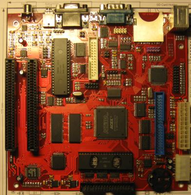

## О гарантиях

Плата поставляется в рабочем состоянии и прошедшей полноценное тестирование. То есть она поставляется заведомо исправной.

Цена платы не включает в себя какие либо дополнительные стоимости, кроме стоимости ее сборки. То есть цена не включает в себя стоимость возможного гарантийного ремонта . Поэтому поставщик не несет какой либо ответственности в любом случае и не осуществляет гарантийных ремонтов. В случае неисправности, поставщик готов произвести платный ремонт (стоимость ремонта обсуждается непосредственно с поставщиком).

## Введение

ZX Evolution представляет собой Спектрум совместимый компьютер. Компьютер основан на программируемой логической матрице Altera EP1K50Q208 и обладает гибкой архитектурой, что позволяет проводить обновление и исправление ошибок схемы без применения паяльника и прочих радикальных подходов. Тем не менее, при проектировании заложено сохранение оригинальных основных блоков (т.е. используются оригинальные микросхемы, а не их эмуляция в программируемой логической матрице).

Материнская плата ZX Evolution спроектирована для легкой установки в современный корпус (miniITX, microATX, ATX), и к ней можно подсоединить современную периферию и носители информации.

Характеристики компьютера:

- Процессор Z80 на частоте 3.5 (стандартный режим) / 7 (turbo режим без wait на процессоре) / 14 МГц (turbo+ режим с использованием wait);
- 4 МБайт оперативной памяти, 512КБайт постоянной памяти с возможностью перезаписи (flash ROM);
- Форм фактор miniITX, с возможностью работы с БП ATX или нестандартного с +5В и +12В;
- 2 слота ZXBUS;
- Периферийный контроллер ATMEGA128;
- Контроллер PS/2 клавиатуры/мыши;
- Контроллер IDE (один канал, поддержка до двух устройств в режиме master/slave);
- Контроллер SD(HC) карт памяти;
- Контроллер floppy disk на основе КР1818ВГ93 с поддержкой до 4-ех дисководов;
- Контроллер RS232 интерфейса;
- Встроенный USB-RS232 переходник;
- Энергонезависимые часы-календарь (RTC);
- Звуковой интерфейс на основе AY38910/YM2149F, beeper, аппаратный шим;
- Принтерный интерфейс по стандарту AY-принтер;
- Поддержка механической клавиатуры и джойстиков;
- Поддержка tape интерфейса (магнитофонный вход/выход);
- RGB видеовыход (для подключения через SCART);
- VGA выход с аппаратным скандабблером.

## Описание платы

На рисунке показаны основные компоненты компьютера и разъемы:

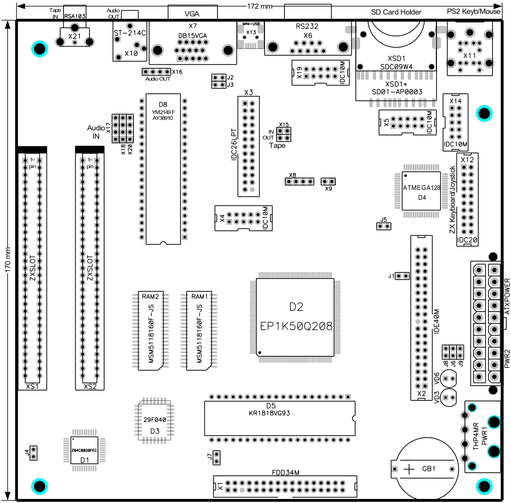

Плата оснащена отверстиями для крепления в корпус miniITX согласно спецификации[^1]. Также основные рабочие разъемы для подсоединения периферии расположены в «окне» ATX корпуса, что облегчает установку платы и доступ к разъемам.

Слоты спроектированы так, чтобы платы, установленные в них, попадали точно в предназначенное для выходов окно на задней стенке корпуса (на текущий момент поддерживается плата NeoGS). Сторонним производителям, проектирующим платы следует придерживаться форм фактора платы NeoGS.

Плата оснащена стандартными разъемом ATX питания, позволяющим подключить серийный блок питания.

## Описание разъемов

### X1. Floppy disk

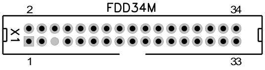

Разъем предназначен для подключения носителя(ей) гибкого диска (3.5' или 5.25'). Поддерживается до четырех устройств.
Нумерация разъема идет от квадратной площадки.

Описание контактов:

| №   | Название | Комментарий         | №   | Название | Комментарий                     |
|-----|----------|---------------------|-----|----------|---------------------------------|
| 1   | GND      | Земля               | 2   |          | Не используется                 |
| 3   | GND      | Земля               | 4   |          | Не используется                 |
| 5   | KEY      | Ключ (контакта нет) | 6   | DS3      | Выбор 3 носителя                |
| 7   | GND      | Земля               | 8   | IDX      | Сигнал индексной метки          |
| 9   | GND      | Земля               | 10  | DS0      | Выбор 0 носителя                |
| 11  | GND      | Земля               | 12  | DS1      | Выбор 1 носителя                |
| 13  | GND      | Земля               | 14  | DS2      | Выбор 2 носителя                |
| 15  | GND      | Земля               | 16  | MOTON    | Включение мотора                |
| 17  | GND      | Земля               | 18  | DIRC     | Выбор направления шага          |
| 19  | GND      | Земля               | 20  | STEP     | Шаг головки на след. дорожку    |
| 21  | GND      | Земля               | 22  | WD       | Записываемые данные             |
| 23  | GND      | Земля               | 24  | WG       | Разрешение записи               |
| 25  | GND      | Земля               | 26  | TR00     | Головка на 00 дорожке           |
| 27  | GND      | Земля               | 28  | WP       | Состояние «защиты записи» диска |
| 29  | GND      | Земля               | 30  | RDDATA   | Считываемые данные              |
| 31  | GND      | Земля               | 32  | SIDE1    | Выбор стороны дискеты           |
| 33  | GND      | Земля               | 34  |          | Не используется                 |

### X2. IDE

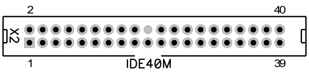

Разъем предназначен для подключение IDE накопителей. Возможно подключение до двух устройств в режиме master/slave.
Нумерация разъема идет от квадратной площадки.

Описание контактов:

| № | Название | Комментарий | № | Название | Комментарий |
|----|----|----|----|----|----|
| 1 | RESET | Аппаратный сброс | 2 | GND | Земля |
| 3 | D07 | 7 разряд шины данных | 4 | D08 | 8 разряд шины данных |
| 5 | D06 | 6 разряд шины данных | 6 | D09 | 9 разряд шины данных |
| 7 | D05 | 5 разряд шины данных | 8 | D10 | 10 разряд шины данных |
| 9 | D04 | 4 разряд шины данных | 10 | D11 | 11 разряд шины данных |
| 11 | D03 | 3 разряд шины данных | 12 | D12 | 12 разряд шины данных |
| 13 | D02 | 2 разряд шины данных | 14 | D13 | 13 разряд шины данных |
| 15 | D01 | 1 разряд шины данных | 16 | D14 | 14 разряд шины данных |
| 17 | D00 | 0 разряд шины данных | 18 | D15 | 15 разряд шины данных |
| 19 | GND | Земля | 20 | KEY | Ключ (контакта нет) |
| 21 |  | Не используется | 22 | GND | Земля |
| 23 | DIOW |  | 24 | GND | Земля |
| 25 | DIOR |  | 26 | GND | Земля |
| 27 | IORDY |  | 28 |  | Не используется |
| 29 |  | Не используется | 30 | GND | Земля |
| 31 |  | Не используется | 32 |  | Не используется |
| 33 | DA1 | 1 разряд адреса регистра | 34 |  | Не используется |
| 35 | DA0 | 0 разряд адреса регистра | 36 | DA2 | 1 разряд адреса регистра |
| 37 | CS0 | Сигнал выбора набора регистров | 38 | CS1 | Сигнал выбора набора регистров |
| 39 | DASP | Индикатор обмена данными | 40 | GND | Земля |

### X3. Разъем для подключения принтера (неполный LPT).

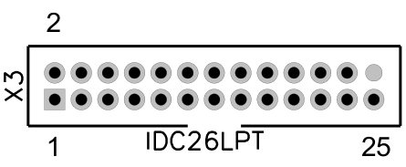

Разъем предназначен для подключения принтера (рекомендуется использовать EPSON совместимый принтер).
Нумерация разъема идет от квадратной площадки.

Описание контактов:

| №   | Название | Комментарий              | №   | Название | Комментарий         |
|-----|----------|--------------------------|-----|----------|---------------------|
| 1   | STROBE   | Сигнал строба            | 2   |          | Не используется     |
| 3   | DATA0    | 0 разряд данных          | 4   | ERROR    | Сигнал ошибки       |
| 5   | DATA1    | 1 разряд данных          | 6   |          | Не используется     |
| 7   | DATA2    | 2 разряд данных          | 8   |          | Не используется     |
| 9   | DATA3    | 3 разряд данных          | 10  | GND      | Земля               |
| 11  | DATA4    | 4 разряд данных          | 12  | GND      | Земля               |
| 13  | DATA5    | 5 разряд данных          | 14  | GND      | Земля               |
| 15  | DATA6    | 6 разряд данных          | 16  | GND      | Земля               |
| 17  | DATA7    | 7 разряд данных          | 18  | GND      | Земля               |
| 19  |          | Не используется          | 20  | GND      | Земля               |
| 21  | BUSY     | Сигнал занятости         | 22  | GND      | Земля               |
| 23  | PE       | Сигнал отсутствия бумаги | 24  | GND      | Земля               |
| 25  |          | Не используется          | 26  | KEY      | Ключ (контакта нет) |

### X4. JTAG для программируемой матрицы EP1K50Q208

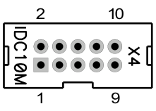

Разъем предназначен для программирования FPGA EP1K50Q208 по интерфейсу JTAG с помощью программатора ByteBlasterMV или любого другого, поддерживающего указанный интерфейс. Нумерация разъема идет от квадратной площадки.

Описание контактов:

| № | Название | Комментарий | № | Название | Комментарий |
|----|----|----|----|----|----|
| 1 | TCK | Тактовый сигнал (clock) | 2 | GND | Земля |
| 3 | TDO | Выходные данные (data output) | 4 | 3V3 | Напряжение питания +3.3В |
| 5 | TMS | Управляющий сигнал (mode select) | 6 |  | Не используется |
| 7 |  | Не используется | 8 |  | Не используется |
| 9 | TDI | Входные данные (data input) | 10 | GND | Земля |

### X5. AVR ISP для периферийного контроллера ATMEGA128

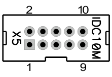

Разъем предназначен для программирования периферийного контроллера ATMEGA128 по интерфейсу ISP с помощью программатора ByteBlasterMV или любого другого, поддерживающего указанный интерфейс. Нумерация разъема идет от квадратной площадки.

Описание контактов:

| № | Название | Комментарий | № | Название | Комментарий |
|----|----|----|----|----|----|
| 1 | CK | Тактовый сигнал (clock) | 2 | GND | Земля |
| 3 | DO | Выходные данные (data output) | 4 | VCC5 | Напряжение питания +5В |
| 5 | RST | Сброс (reset) | 6 |  | Не используется |
| 7 |  | Не используется | 8 | EXCLOCK | Внешний тактовый сигнал |
| 9 | DI | Входные данные (data input) | 10 | GND | Земля |

### X6. RS232 коммуникационный порт

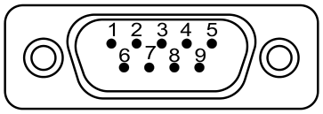

Коммуникационный порт предназначен для соединения с другим компьютером либо с коммуникационным оборудованием (например, с модемом).

Описание контактов:

| № | Название | Комментарий | № | Название | Комментарий |
| --- | --- | --- | --- | --- | --- |
| 1 |  | Не используется | 6 |  | Не используется (замкнут на 4 вывод) |
| 2 | RXD |  | 7 | RTS |  |
| 3 | TXD |  | 8 | CTS |  |
| 4 |  | Не используется (замкнут на 6 вывод). | 9 |  | Не используется |
| 5 | GND | Земля | Корпус |  | Корпус разъема соединен с землей |

### X7. VGA видеовыход

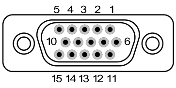

Разъем предназначен для подключения монитора или телевизора, оснащенного VGA разъемом.
Внимание: Наличие VGA разъема не гарантирует совместимость с компьютером. Для полной совместимости монитор должен поддерживать развертку 50ГЦ, 31KГц. [Список протестированных мониторов](./supported_monitors.md)

Описание контактов:

| № | Название | Комментарий | № | Название | Комментарий |
| --- | --- | --- | --- | --- | --- |
| 1 | R | Красная компонента видеосигнала | 9 | VIDEOVCC | Не используется или +5V (если замкнут джампер J3) |
| 2 | G | Зеленая компонента видеосигнала | 10 | GND | Земля |
| 3 | B | Синяя компонента видеосигнала | 11 | GND | Земля |
| 4 |  | Не используется | 12 |  | Не используется |
| 5 |  | Не используется | 13 | HS | Строчная синхронизация |
| 6 | GND | Земля | 14 | VS | Кадровая синхронизация |
| 7 | GND | Земля | 15 | CSYNC | Не используется или смешанная синхронизация (если замкнут джампер J2) |
| 8 | GND | Земля | Корпус |  | Корпус разъема соединен с землей |

### X8. Видеовыход RGB + смешанная синхронизация

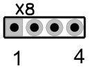

Разъем предназначен для подключения телевизора, монитора или PAL-кодера по RGBC. Рекомендуется использовать совместно с X9 для подключения PAL-кодера от NedoPC.
Нумерация разъема идет от квадратной площадки.

Описание контактов:

| № | Название | Комментарий | № | Название | Комментарий |
|----|----|----|----|----|----|
| 1 | R | Красная компонента видеосигнала | 2 | G | Зеленая компонента видеосигнала |
| 3 | B | Синяя компонента видеосигнала | 4 | CSYNC | Смешанная синхронизация |

### X9. Питание для видеовыхода

| № | Название | Комментарий |
|----|----|----|
| 1 | GND | земля |
| 2 | VIDEOVCC |питание +5В |

Рекомендуется использовать совместно с X8 для подключения PAL-кодера от NedoPC.
Нумерация разъема идет от квадратной площадки.

### X10. 3.5 Аудиовыход

Разъем предназначен для подключения колонок, наушников и других воспроизводящих или записывающих устройств.

Корпус разъема соединен с землей.

### X11. PS/2 клавиатура и мышь

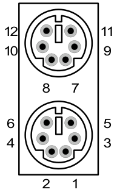

Разъем предназначен для подсоединения PS/2 клавиатуры и мыши. Клавиатура подключается в ближнее к плате гнездо разъема, мышь подключается в дальнее от платы гнездо.
Корпус разъема соединен с землей.

Описание контактов:

| №   | Название | Комментарий                | №   | Название | Комментарий            |
|-----|----------|----------------------------|-----|----------|------------------------|
| 1   | DATA     | Данные клавиатуры          | 7   | DATA     | Данные мыши            |
| 2   |          | Не используется            | 8   |          | Не используется        |
| 3   | GND      | Земля                      | 9   | GND      | Земля                  |
| 4   | +5V      | Напряжение питания +5В     | 10  | +5V      | Напряжение питания +5В |
| 5   | CLK      | Тактовый сигнал клавиатуры | 11  | CLK      | Тактовый сигнал мыши   |
| 6   |          | Не используется            | 12  |          | Не используется        |

### X12. Механическая клавиатура и джойстик

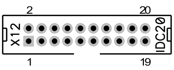

Разъем предназначен для подключение механической (оригинальной) ZX клавиатуры и Kempston джойстика.
Нумерация разъема идет от квадратной площадки.

Описание контактов:

| № | Название | Комментарий | № | Название | Комментарий |
| --- | --- | --- | --- | --- | --- |
| 1 | ZXROW0 | 0 ряд механической клавиатуры | 2 | ZXROW1 | 1 ряд механической клавиатуры |
| 3 | ZXROW2 | 2 ряд механической клавиатуры | 4 | ZXROW3 | 3 ряд механической клавиатуры |
| 5 | ZXROW4 | 4 ряд механической клавиатуры | 6 | ZXROW5 | 5 ряд механической клавиатуры |
| 7 | ZXROW6 | 6 ряд механической клавиатуры | 8 | ZXROW7 | 7 ряд механической клавиатуры |
| 9 | RST | Сигнал сброса | 10 | ZXCOL4 | 4 столбец механической клавиатуры |
| 11 | ZXCOL3 | 3 столбец механической клавиатуры | 12 | ZXCOL2 | 2 столбец механической клавиатуры |
| 13 | ZXCOL1 | 1 столбец механической клавиатуры | 14 | ZXCOL0 | 0 столбец механической клавиатуры |
| 15 | GND | Земля | 16 | JOYL | Вывод «влево» джойстика |
| 17 | JOYR | Вывод «вправо» джойстика | 18 | JOYU | Вывод «вверх» джойстика |
| 19 | JOYD | Вывод «вниз» джойстика | 20 | JOYF | Вывод «огонь» джойстика |

#### Подсоединение Kempston и Sinclair джойстиков

<table>
<thead>
<tr>
  <th colspan="3">Sinclair 1</th>
  <th colspan="3">Sinclair 2</th>
  <th colspan="2">Kempston</th>
</tr>
<tr>
  <th>Функция</th>
  <th>Кнопка ZX</th>
  <th>Замыкаем контакты X12</th>
  <th>Функция</th>
  <th>Кнопка ZX</th>
  <th>Замыкаем контакты X12</th>
  <th>Функция</th>
  <th>Замыкаем контакты X12</th>
</tr>
</thead>
<tbody>
<tr>
  <td>влево</td>
  <td>1</td>
  <td>4 - 14</td>
  <td>влево</td>
  <td>6</td>
  <td>5 - 10</td>
  <td>влево</td>
  <td>15 - 16</td>
</tr>
<tr>
  <td>вправо</td>
  <td>2</td>
  <td>4 - 13</td>
  <td>вправо</td>
  <td>7</td>
  <td>5 - 11</td>
  <td>вправо</td>
  <td>15 - 17</td>
</tr>
<tr>
  <td>вниз</td>
  <td>3</td>
  <td>4 - 12</td>
  <td>вниз</td>
  <td>8</td>
  <td>5 - 12</td>
  <td>вверх</td>
  <td>15 - 18</td>
</tr>
<tr>
  <td>вверх</td>
  <td>4</td>
  <td>4 - 11</td>
  <td>вверх</td>
  <td>9</td>
  <td>5 - 13</td>
  <td>вниз</td>
  <td>15 - 19</td>
</tr>
<tr>
  <td>огонь</td>
  <td>5</td>
  <td>4 - 10</td>
  <td>огонь</td>
  <td>0</td>
  <td>5 - 14</td>
  <td>огонь</td>
  <td>15 - 20</td>
</tr>
</tbody>
</table>

### X13. Mini USB (выход USB-RS232 моста)

Предназначен для подключению к управляющему компьютеру в режиме USB-slave. Используется для соединения с другими компьютерами, не оснащенными RS232 портом.

### X14. AVR JTAG для периферийного контроллера ATMEGA128

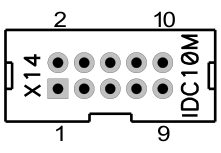

Разъем предназначен для программирования периферийного контроллера ATMEGA128 по интерфейсу JTAG ICT с помощью программатора, поддерживающего указанный интерфейс.
Нумерация разъема идет от квадратной площадки.

Описание контактов:

| № | Название | Комментарий | № | Название | Комментарий |
|----|----|----|----|----|----|
| 1 | TCK | Тактовый сигнал (clock) | 2 | GND | Земля |
| 3 | TDO | Выходные данные (data output) | 4 | VCC | Напряжение питания +5В |
| 5 | TMS | Управляющий сигнал (mode select) | 6 | PRGRST | Сброс |
| 7 | VCC | Напряжение питания +5В | 8 |  | Не используется |
| 9 | TDI | Входные данные (data input) | 10 | GND | Земля |

### X15. Tape (магнитофонный) вход/выход

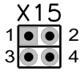

Разъем предназначен для работы с магнитофонным носителем информации.
Нумерация разъема идет от квадратной площадки.

Описание контактов:

| №   | Название | Комментарий                      | №   | Название | Комментарий |
|-----|----------|----------------------------------|-----|----------|-------------|
| 1   | IN       | Вход для магнитофонного сигнала  | 2   | GND      | Земля       |
| 3   | OUT      | Выход для магнитофонного сигнала | 4   | GND      | Земля       |

### X16. Аудиовыход (дублирующий X10)

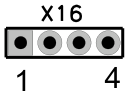

Аудиовыход дублирует разъем X10. Предназначен для подключения колонок, наушников и других воспроизводящих или записывающих устройств.
Нумерация разъема идет от квадратной площадки.

Описание контактов:

| №   | Название | Комментарий         | №   | Название | Комментарий          |
|-----|----------|---------------------|-----|----------|----------------------|
| 1   | LOUT     | Выход левого канала | 2   | GND      | Земля                |
| 3   | GND      | Земля               | 4   | ROUT     | Выход правого канала |

### X17, X18, X20. Аудиовходы

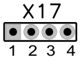

Аудиовходы предназначены для подключения внешних источников звука (например, CDROM или NeoGS).
Нумерация разъема идет от квадратной площадки.

Описание контактов:

| №   | Название | Комментарий        | №   | Название | Комментарий         |
|-----|----------|--------------------|-----|----------|---------------------|
| 1   | LIN      | Вход левого канала | 2   | GND      | Земля               |
| 3   | GND      | Земля              | 4   | RIN      | Вход правого канала |

### X19. RS232 коммуникационный порт (дублирует X6)

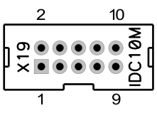

Коммуникационный порт предназначен для соединения с другим компьютером либо с коммуникационным оборудованием (например, с модемом).Нумерация разъема идет от квадратной площадки.

Описание контактов:

| № | Название | Комментарий | № | Название | Комментарий |
|----|----|----|----|----|----|
| 1 |  | Не используется | 2 | RXD |  |
| 3 | TXD |  | 4 |  | Не используется (замкнут на 6 вывод) |
| 5 | GND | Земля | 6 |  | Не используется (замкнут на 4 вывод) |
| 7 | RTS |  | 8 | CTS |  |
| 9 |  | Не используется | 10 | +5V | Питание +5В |

### X21. Магнитофонный вход Tape IN (дублирует часть X15)

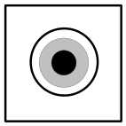

Вход для загрузки компьютера с магнитофона или подобного источника сигнала.

### PWR1. Разъем питания

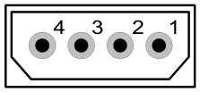

Разъем для подключения нестандартного источника питания.

Описание контактов:

| №   | Название | Комментарий            | №   | Название | Комментарий             |
|-----|----------|------------------------|-----|----------|-------------------------|
| 1   | VCC5     | Напряжение питания +5В | 3   | GND      | Земля                   |
| 2   | GND      | Земля                  | 4   | VCC12    | Напряжение питания +12В |

### PWR2. Разъем ATX питания

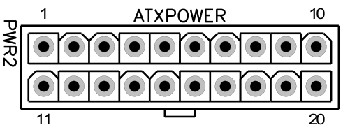

Разъем предназначен для подачи питания на плату ZX Evolution при использовании стандартного ATX блока питания.

Описание контактов:

| № | Название | Комментарий | № | Название | Комментарий |
|----|----|----|----|----|----|
| 1 |  | Не используется | 11 |  | Не используется |
| 2 |  | Не используется | 12 |  | Не используется |
| 3 | GND | Земля | 13 | GND | Земля |
| 4 | VCC5 | Напряжение питания +5В | 14 | PS_ON | Включить питание |
| 5 | GND | Земля | 15 | GND | Земля |
| 6 | VCC5 | Напряжение питания +5В | 16 | GND | Земля |
| 7 | GND | Земля | 17 | GND | Земля |
| 8 | PWRGOOD | Напряжение установлено | 18 |  | Не используется |
| 9 | VCC5STBY | Напряжение питания +5В standby | 19 | VCC5 | Напряжение питания +5В |
| 10 | VCC12 | Напряжение питания +12В | 20 | VCC5 | Напряжение питания +5В |

### GB1. Держатель батарейки питания часов

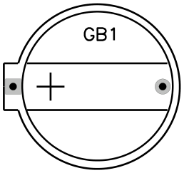

Предназначен для установки батарейки для питания энергонезависимой памяти и часов (PCF8583).
Рекомендуется устанавливать батарейки в CR2032 корпусе, напряжением 3 вольта.

  

## Назначение джамперов (контактных перемычек) и кнопок

| № | Название | По умолчанию | Описание |
| --- | --- | --- | --- |
| J1 | enable IDERES | разомкнуто | В замкнутом положении разрешает прохождение сигнала RESET на IDE разъем, что позволяет сбрасывать IDE устройства через сигнал интерфейса. Необходимо некоторым устаревшим моделям винчестеров (например, марки Samsung). |
| J2 | enable composite sync to VGA | разомкнуто | В замкнутом положении разрешает прохождение сигнала композитной синхронизации на VGA разъеме. |
| J3 | enable +5V to VGA | разомкнуто | В замкнутом положении подает напряжение питания +5В на разъем VGA. |
| J4 | 12v enable | разомкнуто | В замкнутом положении на слоты подается напряжение питания +12В. |
| J5 | external clock | разомкнуто | В замкнутом положении позволяет тактировать ATMEGA128 c внешнего источника, подключенного через AVR ISP разъем (X5) |
| J6 | soft reset key | разомкнуто | Группа контактов c двойным значением: - для подключения кнопки «PWR SW» при использовании корпуса ATX; - мягкий сброс компьютера (без рестарта ATMEGA128). |
| J7 | HRDY-&gt;IP | разомкнуто | В замкнутом состоянии сигнал HRDY притягивает к GND сигнал IP |
| J8 | NMI key | разомкнуто | В замкнутом состоянии подает сигнал NMI на процессор Z80. |
| J9 | hard reset key | разомкнуто | В замкнутом положении сбрасывает компьютер включая сброс ATMEGA128. Предназначена для подключения кнопки «Reset» AT или ATX корпуса. |
| VD3[^2] | HDD Led |  | Предназначено для подключения светодиода «HDD LED» корпуса AT или ATX |
| VD6[^3] | PWR Led |  | Предназначено для подключения светодиода «PWR LED» корпуса AT или ATX |

## Слоты ZXBUS

Компьютер ZX Evolution имеет два слота совместимые с ZXBUS.

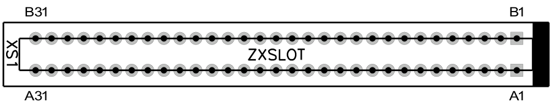

Шаг контактов ZXBUS — 2.54мм. Будьте осторожны при установке плат производства 90-ых годов и ранее, у них шаг 2.5мм.

Первые контакты рядов слота отмечены квадратной площадкой. При установке в ATX корпус первый контакт будет ближним к задней стенке корпуса компьютера.

**Внимание:** При установке плат расширения следите, чтобы направляющий выступ платы расширения был со стороны первого контакта. Если плата расширения не оснащена направляющим выступом, то обязательно сверьтесь с руководством, поставляемым с платой. Помните, неправильная установка платы может привести к уничтожению элементов как платы, так и компьютера.

**Внимание:** Производитель ZX Evolution не несет ответственности за неработоспособность и возможные повреждения в случае использования плат расширения сторонних производителей. Также производитель ZX Evolution не берет на себя обязанности тестировать работоспособность плат расширения от сторонних производителей. Вопросы совместимости решайте с производителями плат расширения.

**Замечание:** Если плата расширения требует питания +12В, то нужно установить перемычку (джампер) на контактную пару J4.

Описание контактов слота:

| № | Название | Комментарий | № | Название | Комментарий |
|----|----|----|----|----|----|
| A1 | A14 | 14 разряд шины адреса процессора | B1 | A15 | 15 разряд шины адреса процессора |
| A2 | A12 | 12 разряд шины адреса процессора | B2 | A13 | 13 разряд шины адреса процессора |
| A3 | +5V | Напряжение питания +5В | B3 | D7 | 7 разряд шины данных процессора |
| A4 | DCDOS | Сигнал работы в окне TRDOS | B4 |  | Не используется |
| A5 |  | Не используется | B5 |  | Не используется |
| A6 | GND | Земля | B6 | D0 | 0 разряд шины данных процессора |
| A7 | GND | Земля | B7 | D1 | 1 разряд шины данных процессора |
| A8 |  | Не используется | B8 | D2 | 2 разряд шины данных процессора |
| A9 | A0 | 0 разряд шины адреса процессора | B9 | D6 | 6 разряд шины данных процессора |
| A10 | A1 | 1 разряд шины адреса процессора | B10 | D5 | 5 разряд шины данных процессора |
| A11 | A2 | 2 разряд шины адреса процессора | B11 | D3 | 3 разряд шины данных процессора |
| A12 | A3 | 3 разряд шины адреса процессора | B12 | D4 | 4 разряд шины данных процессора |
| A13 | IORQGE | Сигнал подавления других блоков | B13 | INT | Прерывание |
| A14 | GND | Земля | B14 | NMI | Немаскируемое прерывание |
| A15 | CSROMCE | Разрешение выборки ROM | B15 | HALT | Сигнал останова процессора |
| A16 | RS | Сигнал переключения окна ROM | B16 | MREQ | Запрос памяти процессором |
| A17 |  | Не используется | B17 | IORQ | Запрос вывода в порт процессором |
| A18 |  | Не используется | B18 | RD | Чтение данных процессором |
| A19 | BUSRQ | Запрос на DMA | B19 | WR | Запись данных процессором |
| A20 | RES | Сигнал сброса | B20 |  | Не используется |
| A21 | A7 | 7 разряд шины адреса процессора | B21 | WAIT | Ожидание |
| A22 | A6 | 6 разряд шины адреса процессора | B22 |  | Не используется |
| A23 | A5 | 5 разряд шины адреса процессора | B23 |  | Не используется |
| A24 | A4 | 4 разряд шины адреса процессора | B24 | M1 | Начало цикла обработки команды |
| A25 | CSROM | Выбран ROM | B25 | RFSH | Регенерация памяти |
| A26 | BUSAK | Разрешение DMA | B26 | A8 | 8 разряд шины адреса процессора |
| A27 | A9 | 9 разряд шины адреса процессора | B27 | A10 | 10 разряд шины адреса процессора |
| A28 | A11 | 11 разряд шины адреса процессора | B28 | +5V | Напряжение питания +5В |
| A29 | +5V | Напряжение питания +5В | B29 | +12V | Напряжение питания +12В |
| A30 | GND | Земля | B30 | GND | Земля |
| A31 |  | На XS1 – IORQGE2, на XS2 не используется | B31 |  | На XS1 – IORQ2, на XS2 не используется |

## О прошивках для ZX Evolution

ZX Evo содержит микроконтроллер ATMEGA128 и микросхему ПЗУ 29F040.

Микроконтроллер ATMEGA128 несет три функции:

- Управляет внешней периферией, преобразовывая взаимодействия от внешних устройств в стандарты принятые в ZX Spectrum;
- Загружает firmware в программируемую матрицу EP1K50QC208 при включении или «hardware» сбросе компьютера;
- Позволяет обновлять конфигурации компьютера, т.е. обновлять или менять изменяемую часть прошивки микроконтроллера.

Прошивка ATMEGA128 состоит из двух частей:

- **BOOTLOADER** – неизменяемая часть прошивки предназначенная для смены/обновления изменяемой части прошивки микроконтроллера (см. соответствующую документацию на bootloader). Эту прошивку можно прошить исключительно программатором на собранной плате (в составе конструктора для самостоятельной сборки микроконтроллер поставляется без прошивок). Обновить bootloader на новую версию, возможно только имея программатор. Соответственно на сайте bootloader доступен в виде бинарных файлов для двух типов программаторов.
- **Конфигурация** – изменяемая часть прошивки, которая собственно занимается управлением периферией и загрузкой конфигурации компьютера. Конфигурации могут быть от разных разработчиков, также существуют специальные сервисные конфигурации для настройки и проверки компьютера после сборки. Конфигурации доступны в виде специальным образом подготовленных файлов **zxevo_fw.bin** .

**Внимание:** NedoPC разрабатывает и ведет поддержку двух конфигураций:

- **TEST&SERVICE** – конфигурация для настройки и проверки компьютера после сборки, а также для прошивки/обновления микросхемы ПЗУ 29F040;
- **BASECONF** – базовая конфигурация, является эталонной (образцовой) конфигурацией для компьютера. Пишется разработчиками из NedoPC согласно их представлениям о развитии ZX Spectrum. Сторонние разработчики могут брать исходные коды в качестве образца для своих конфигураций.

**Внимание:** NedoPC не осуществляет поддержку/развитие конфигураций от сторонних разработчиков, не несет ответственности за неправильное функционирование ZX Evolution в случае использовании таких конфигураций.

Прошивка для ПЗУ 29F040 содержит реализации необходимых подпрограмм для работы компьютера в режиме ZX Spectrum (Basic48, Basic128, TRDOS и прочее). Прошивка поставляется в виде бинарного файла **zxevo.rom**, содержащего полный образ для загрузки в ПЗУ 29F040. Содержимое ПЗУ может компоноваться сторонними разработчиками по своему усмотрению.

Для обновления или восстановления образа ПЗУ можно воспользоваться конфигурацией **TEST&SERVICE**:

- С помощью **BOOTLOADER** загрузите конфигурацию **TEST&SERVICE**;
- Запишите файл **zxevo.rom** на SD карту и установите ее в компьютер;
- Выберите соответствующий пункт меню в конфигурации **TEST&SERVICE** и прошейте ПЗУ;
- С помощью **BOOTLOADER** загрузите рабочую конфигурацию (например **BASECONF**).

**Внимание:** NedoPC поставляет свою версию образа ПЗУ, основой которой является **EVO RESET SERVICE**. Эта версия ПЗУ оптимально сочетается с рабочей конфигурацией **BASECONF** от NedoPC. Рабочую конфигурацию и образ ПЗУ рекомендуется обновлять одновременно, так как в случае использования старого образа ПЗУ с новой рабочей конфигурацией (или наоборот), могут произойти сбои в работе. **EVO RESET SERVICE** позволяет обновлять образ ПЗУ непосредственно из себя (смотрите соответствующую документацию).

## Установка платы в корпус ATX/miсroATX/miniITX

Формфактор платы ZX Evolution спроектирован с учетом простоты установки в стандартный корпус ATX, microATX, miniITX.

**Внимание:** В комплект поставки платы ZX Evolution не включены крепежная фурнитура и заглушки.

Этапы установки в подобный корпус:

1.  Установите батарейку CR2032 или подобную в держатель GB1 на плате.
2.  Установите плату на крепеж установочной пластины корпуса и закрепите винтами. Крепежную пластину установите в корпус. Разъемы платы (X21, X10, X7, X13, X6, XSD1, X11) должны выходить в «окно» корпуса.
3.  Подсоедините шлейф от блока питания к разъему PWR2.
4.  Подсоедините шлейф RES SW от кнопки «Reset» на корпусе к контактной паре J9 «hard reset» на плате.
5.  Подсоедините шлейф PWR SW от кнопки «Power» на корпусе к контактной паре J6 «soft reset» на плате.
6.  Подсоедините шлейф IDE LED от светодиода «Ide» на корпусе к контактной паре VD3[^2] платы (положительный контакт имеет квадратную площадку).
7.  Подсоедините шлейф PWR LED от светодиода «Power» на корпусе к контактной паре VD6[^3] платы (положительный контакт имеет квадратную площадку).
8.  Установите Floppy привод(ы)[^4] в корпус, подсоедините к ним питание и подсоедините шлейфом к разъему X1 платы.  
    **Внимание:** Шлейф для floppy привода отличается от стандартного PC шлейфа, пример шлейфа смотрите в приложении.
9.  Установите IDE устройство(а)[^5] в корпус, подсоедините к ним питание и подсоедините шлейфом к разъему X2 платы.  
    **Внимание:** Установить два IDE устройства можно только в режиме master/slave.

Управление питанием несколько отличается от классической реализации (PC реализации):

| Операция | Действие |
| --- | --- |
| Включение питания (для ATX БП) | Кратковременное замыкание «soft reset» [J6] (PWR SW) Кратковременное замыкание «hard reset» [J9] (RES SW) [не рекомендуется] |
| Отключение питания (для ATX БП) | Замыкание «soft reset» [J6] (PWR SW) в течении 5 секунд Нажатие F12 в течение 5 секунд |
| Сброс процессора | Кратковременное замыкание «soft reset» [J6] (PWR SW) |
| Полный сброс | Кратковременное замыкание «hard reset» [J9] (RES SW) |

## Примечание 1. Подсоединение дисплея

ZX Evolution позволяет работать с двумя типами дисплеев:

- VGA мониторы;
- Телевизионные дисплеи.

При использовании VGA монитора — подсоедините его к разъему VGA (X7). Для работы ZX Evolution с VGA монитором нужно активировать соответствующий режим.

**Внимание:** Переключения режима отображения VGA/TV осуществляется кнопкой на клавиатуре. В случае использования прошивки **BASECONF** от NedoPC – кнопкой «Scroll Lock» (в VGA режиме горит индикатор «Scroll Lock» на клавиатуре).

**Внимание:** При использовании VGA монитора убедитесь, что монитор поддерживает развертку 48.8 Гц. Список протестированных мониторов доступен на сайте проекта ZX Evolution[^6].

На ZX Evolution revision С сделан специальный разъем для подключения RGB монитора (например через SCART-RGB) или подсоединения PAL-кодера. Этот разъем состоит из двух групп контактов — X8,X9.

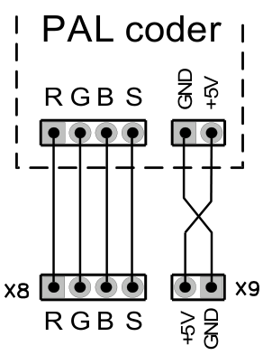

Для подсоединения PAL-кодера необходимо сделать специальный кабель-переходник, как показано на схеме.

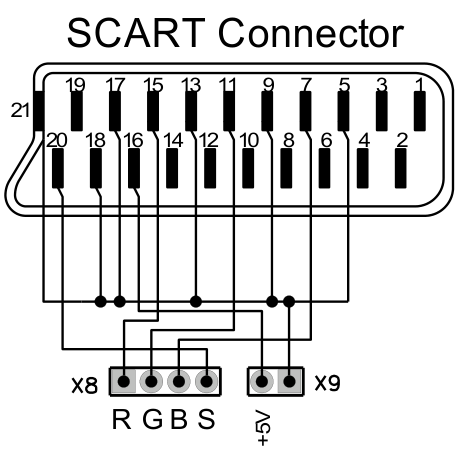

Для подсоединения телевизора по SCART необходимо сделать специальный кабель-переходник, как показано на схеме.
**Внимание:** Телевизор должен поддерживать RGB режим работы SCART.

Согласно вышеуказанным схемам, можно подсоединить телевизор или PAL-кодер через разъем VGA (X7), используя соответствующие контакты. В этом случае, необходимо замкнуть джамперы J2 и J3, чтобы сигнал смешанной синхронизации и питание были доступно с разъема X7.

## Примечание 2. Подсоединение Floppy приводов

Контроллер floppy приводов для PC отличается в способе выбора текущего привода, что позволяет PC работать только с двумя приводами на шлейфе. Контроллер построенный на базе микросхемы КР1818ВГ93 (WDC1793), разрешает работать одновременно с четырьмя приводами.

При установке 5.25 floppy привода, нужно установить его в режим DD(720Kb) и установить номер привода 0 или A (обычно перемычкой DS \[drive select\]). Рекомендуется сверить с документацией на привод.

На 3.5 floppy приводах для PC установлена (или впаяна) перемычка выбора диска так, что он определяется как «B» (второй) носитель, если подсоединить его к ZX Evolution. Чтобы подсоединить два 3.5 привода от PC без их переделки нужно подготовить специальный шлейф:

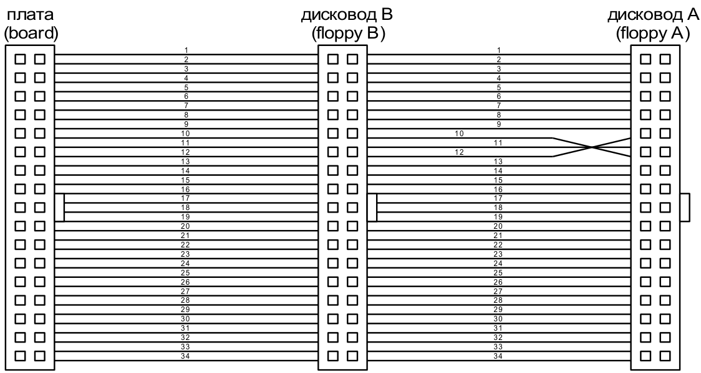

Необходимо учитывать, что в TRDOS используется стандарт DD дискет и привода. Некоторые современные 3.5 дисковые приводы не поддерживают работу в режиме DD. В этом случае необходимо либо доработать привод, либо использовать те которые поддерживают режим DD.

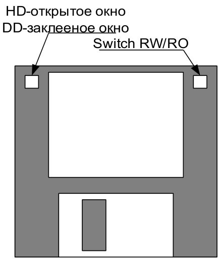

Если вы желаете использовать HD 3.5 дискеты, то их необходимо доработать. Надо заклеить окно на дискете, чтобы она определялась как DD дискета.

## Примечание 3. Дополнительный функционал PS2 клавиатуры (только для “baseconf” конфигурации и “EVO reset service” ROM).

| Комбинация клавиш PS2 клавиатуры | Функция |
| --- | --- |
| “F12” | Мягкий сброс (soft reset). Равнозначно джамперу “soft reset” (J6) платы. Сбрасывает только процессор Z80 (без повторной загрузки конфигурации в компьютер).  **Внимание**: Если “F12” держать нажатой 5 секунд то будет отключено питания (только для ATX блоков питания). |
| “Ctrl”+”Alt”+”Del” | Полный сброс (hard reset). Равнозначно джамперу “hard reset” (J9) платы. Сбрасывание и перезагрузка конфигурации платы ZXEvo. |
| “ScrollLock” | Переключение VGA/TV режима видеовыхода.  Индикатор “ScrollLock” клавиатуры светится при VGA режиме. |
| “PrintScreen” | Генерация NMI (немаскируемого прерывания) на процессор Z80. |
| “NumLock” | Переключение tapeout(магнитофонный выход)/beeper(звуковой выход) режима аудиовыхода.  Индикатор “NumLock” клавиатуры светится при tapeout режиме. |
| левая кнопка мыши + правая кнопка мыши + “*” numpad (дополнительной клавиатуры) | Устанавливает разрешение мыши в значение по умолчанию. |
| левая кнопка мыши + правая кнопка мыши + “+” numpad (дополнительной клавиатуры) | Увеличивает разрешение мыши. |
| левая кнопка мыши + правая кнопка мыши + “-” numpad (дополнительной клавиатуры) | Уменьшает разрешение мыши. |
| ”0”(ноль) + “F12” | (нажмите “0”, затем неотпуская нажмите “F12”, отпустите “F12”, отпустите “0”) Установить режим основной прошивки в “Evo service”. |

[^1]: Плата на 2мм шире, чем задано спецификацией и имеет размер 172х170мм (это сделано, для нормального расположения ZXBUS слота).

[^2]:  Если вместо светодиода VD3 впаяна контактная пара (например, в собранных платах от NedoPC).

[^3]:  Если вместо светодиода VD6 впаяна контактная пара (например, в собранных платах от NedoPC).

[^4]:  Floppy привод не является обязательным, плата работоспособна и без него.

[^5]: IDE устройство не является обязательным, плата работоспособна и без него.

[^6]: http://www.nedopc.com/zxevo/zxevo_supported_monitors.pdf
