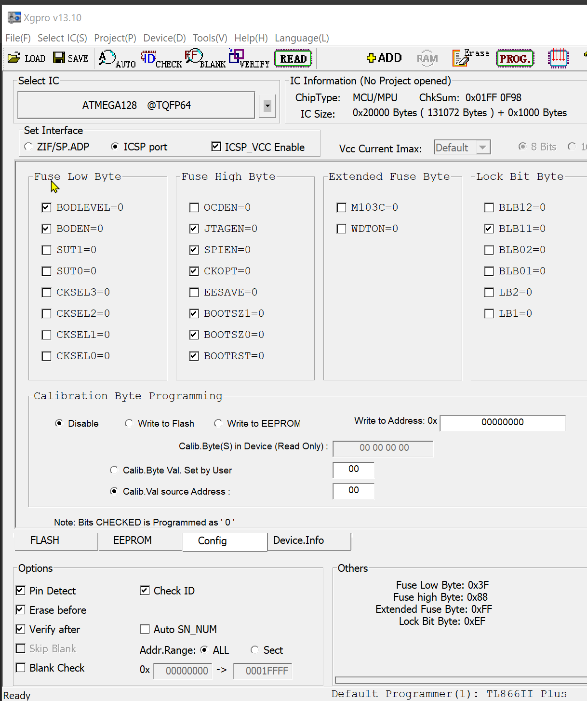
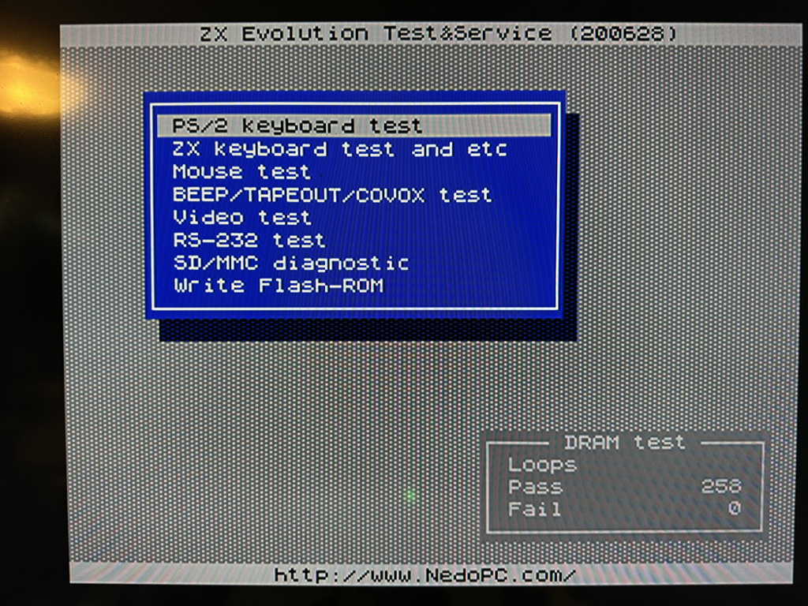
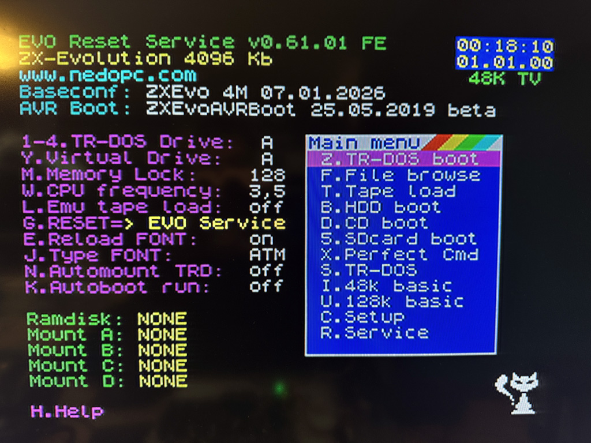

# Конфигурации

ZX Evolution превращается в ZX Spectrum-совместимый компьютер после установки «конфигурации» — кода для микроконтроллера и FPGA.

**Микроконтроллер ATMEGA128**

Управляет периферией: клавиатурой, мышью, SD-карточкой, последовательным портом и джойстиком. Управляет ATX-блоком питания, формирует Reset FPGA, при этом сам ATMEGA128 продолжает работу (Soft reset). Также микроконтроллер загружает конфигурацию в FPGA при включении питания и по Hard reset.

**FPGA Altera EP1K50QC208**

После заливки конфигурации становится клоном спектрума, формирует видеосигнал, работает со звуком AY, контроллером дисковода, слотами расширения ZX Bus.

**Порядок прошивки**
1. Загружаем в ATMEGA128 bootloader при помощи программатора
2. Загружаем TestConf с SD-карты или по последовательному порту
3. Тестируем ZX Evo средствами TestConf 
4. Загружаем ROM через меню TestConf
5. Загружаем конфигурацию с SD-карты или по последовательному порту

[Видео: как прошить ZX Evolution с нуля](https://www.youtube.com/watch?v=mWB4m5wStyA)

## AVR Bootloader
В микроконтроллер ATMEGA128 должен быть однократно записан bootloader. Это делается программатором. Код стабильный и не менялся с 2012 года, если ZX Evolution вам достался готовым и протестированным, скорее всего, bootloader уже установлен. Его назначение — после hard reset найти конфигурацию на SD-карточке или получить её по последовательному порту и загрузить код во flash-память микроконтроллера ATMEGA128 (а тот, в свою очередь, запрограммирует FPGA). Вот новые прошивки ATMEGA и Altera выходят весьма часто, и, говоря об установке конфигурации, обычно имеют в виду именно их.

Документация по прошивке Bootloader:
- [bootloader.pdf](http://svn.nedopc.com/filedetails.php?repname=pentevo&path=%2Favrboot%2Ftrunk%2Fbootloader.pdf)

Схема подключения TL866II к разъёму X5 AVR ISP

| TL866 | Сигнал | X5 |
|----|----|----|
| 1 | Reset | 5 |
| 2 | VCC5 | 4 |
| 3 | GND | 2, 10 | 
| 4 | MOSI | 9 |
| 5 | MISO | 3 |
| 6 | SCK | 1 |

Конфигурация фьюзов при прошивке AVR:

Low byte: `0x3F` High byte: `0x88` Extended: `0xFF` Lock: `0xEF`



## Файлы конфигурации

Классические компьютеры имеют некоторую конфигурацию «железа» и BIOS — набор микропрограмм в ПЗУ, которые запускают компьютер и загружают операционную систему. Аналогично в ZX Evolution файл конфигурации определяет структуру связей в FPGA и функции периферии, подключённой к ATMEGA. Загружая разные конфигурации, мы получаем, по сути, разные компьютеры. Например, BaseConf и TSConf поддерживают разные видеорежимы. Конфигурация FPGA находится внутри файла конфигурации ATMEGA. При включении ATMEGA заливает конфигурацию в FPGA Altera.

ROM-файл — это код, который запускается после инициализации FPGA и служит аналогом микропрограмм BIOS.

Файл конфигурации имеет название ZXEVO_FW.BIN и размер 50-60 Кб.

Файлы ROM заливаются в флэш-память 29F040 и имеют размер ровно 524288 байт.

Сперва прошивается конфигурация, после неё уже можно записать ROM-файл во flash-память. Конфигурацию можно прошить по последовательному порту или с SD-карты, монитор/телевизор при этом не требуется.

## TestConf

Сервисная конфигурация для тестирования и настройки ZXEvo. Состоит из единственного файла `zxevo_fw.bin`, ROM-файл не требуется.
- [Английская версия](http://svn.nedopc.com/filedetails.php?repname=pentevo&path=%2Ftest_n_service%2Ftrunk%2Feng%2Fzxevo_fw.bin)
- [Русская версия](http://svn.nedopc.com/filedetails.php?repname=pentevo&path=%2Ftest_n_service%2Ftrunk%2Frus%2Fzxevo_fw.bin)

Размер файла `zxevo_fw.bin` — 65K. Так как имя файла жёстко закодировано в AVR bootloader, в репозитории ZX Evolution в разных папках лежит несколько файлов различных конфигураций с одинаковым именем, будьте внимательны!

### Загрузка конфигурации с SD-карты
- Отформатировать карту в FAT32
- Положить файл zxevo_fw.bin в корень
- Зажать Soft Reset (J6 на Revision C)
- Подать питание, включив БП в розетку (или нажать hard reset J9)
- Через пару секунд разомкнуть SoftReset
- Через 10 секунд выключить и включить снова

### Загрузка по COM-порту

Файл прошивки можно залить на ZX Evo через RS-232 и нуль-модемный кабель, как [описано в инструкции](../../docs/ZXEvo_firmware_update.md#обновление-с-помощью-нуль-модемного-кабеля), но проще подключить его к PC через USB-кабель. На выведенном на заднюю панель ZX Evolution разъёме X13 Micro USB чип FT232 уже правильно подключён к Evo UART-порту с перекрещёнными сигналами RX и TX. В официальной документации Evo рекомендуется использовать входившую в Windows 98–XP программу HyperTerminal, но в наше время лучше взять более современный софт с поддержкой протокола X-Modem, например [Tera Term](https://github.com/TeraTermProject/teraterm/releases/tag/v5.7.0).

- Соединяем PC с ZX Evo шнуром USB <-> Micro USB
- Включаем ZX Evo
- В Windows Device Manager смотрим номер появившегося COM-порта
- В терминальной программе устанавливаем соединение Speed `115200`, `8 bit`, parity: `none`, `2` stop bits, flow control: `none`.
- Зажимаем Soft Reset
- Коротко нажимаем Hard Reset
- Отпускаем Soft Reset

Должно появиться:
```
 ��������
 ��������  ����� �   �  �����
��������     ��   ���   ����  �   � �����
�������    ��    �� ��  �     �� �� �   �
������     ����� �   �  �����   �    ���

boot: ZXEvoAVRBoot 23.01.2012
main: Test&Service 28.06.2020 beta

Set temporary configuration...
Try update from SD-card...
SD error: Card not found
Try update from RS-232...
Now, start file transfer using X-Modem-CRC protocol.
```

Отправляем по X-Modem файл zxevo_fw.bin
В Tera Term это `File -> Transfer -> XMODEM -> Send`

Заливка идёт несколько секунд, в терминале появится:

```
Try update from RS-232...

Recheck flash...   Ok!

main: Test&Service 04.01.2016 beta

�


          ZX Evolution Test&Service (160104)

ATMEGA128 pins check... No problems found.
Status of POWERGOOD=0, VCC5=0
ATX power up...
Status of POWERGOOD=1, VCC5=1
Set FPGA configuration... Done.
FPGA data exchange test... Ok.
PS/2 keyboard check...
FF FA AA F2 FA AB 83 F0 FA 02 FA F3 FA 00 FA
---

          ZX Evolution Test&Service (160104)
   Sensors:       No card           Read only
Card initialization...
No SD/MMC card found.
Diagnostic is complete.
```



После успешной загрузки должен появиться экран Test&Service и начаться тестирование памяти. При отсутствии картинки или её плохом качестве нажать ScrollLock на клавиатуре для переключения видеорежима TV <-> VGA.

Внимание: TestConf исполняется на ATMEGA и не использует процессор Z80, тесты этой конфигурации не проверяют все возможности ZX Evolution. 

## BaseConf

Базовая конфигурация, разрабатываемая группой NedoPC.
Файлы:
- [ROM zxevo_fe.rom](http://svn.nedopc.com/filedetails.php?repname=pentevo&path=%2From%2Fzxevo_fe.rom)
- [BaseConf zxevo_fw.bin](http://svn.nedopc.com/filedetails.php?repname=pentevo&path=%2Fcfgs%2Fstandalone_base_trdemu%2Ftrunk%2Fzxevo_fw.bin)

Сперва из TestConf прошиваем с SD-карты ROM-файл zxevo_fe.rom (пункт меню Write Flash-ROM), затем обновляем конфигурацию zxevo_fw.bin через последовательный порт или с SD.

Если в TestConf не удалось получить стабильной картинки на мониторе/телевизоре, то ROM можно прошить вслепую — [инструкция](https://youtu.be/mWB4m5wStyA?t=825).

После прошивки ROM прошиваем zxevo_fw.bin, включаем/выключаем компьютер или жмём HardReset, и должен появиться экран EVO Reset Service (ERS).



Видеорежимы переключаются по ScrollLock, после выждать секунд 5. При сброшенном CMOS (без батарейки) порядок режимов:
- 48K TV
- 48K VGA
- 128K TV
- 128K VGA
- PENT TV
- PENT VGA
- 60Hz TV
- 60Hz VGA

При выборе VGA-режимов на PS/2-клавиатуре зажигается Scroll.

В [документации по ERS](../../docs/Описание%20сервис-прошивки%20''EVO%20Reset%20Service''.md) упоминается и более старая версия ROM, без "FE", но она больше не поддерживается. Отличие версии FE в том, что при запуске из главного меню ERS кнопкой S (TR-DOS) будет запущена NEO-DOS 0.60, в которой, кроме обычных команд TR-DOS, можно вводить и добавленные команды, [описанные в документации](../../docs/Описание%20сервис-прошивки%20''EVO%20Reset%20Service''.md#добавленные-возможности).


## TSConf